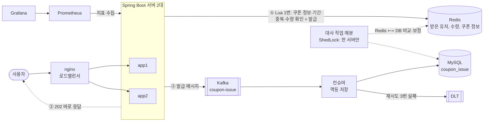
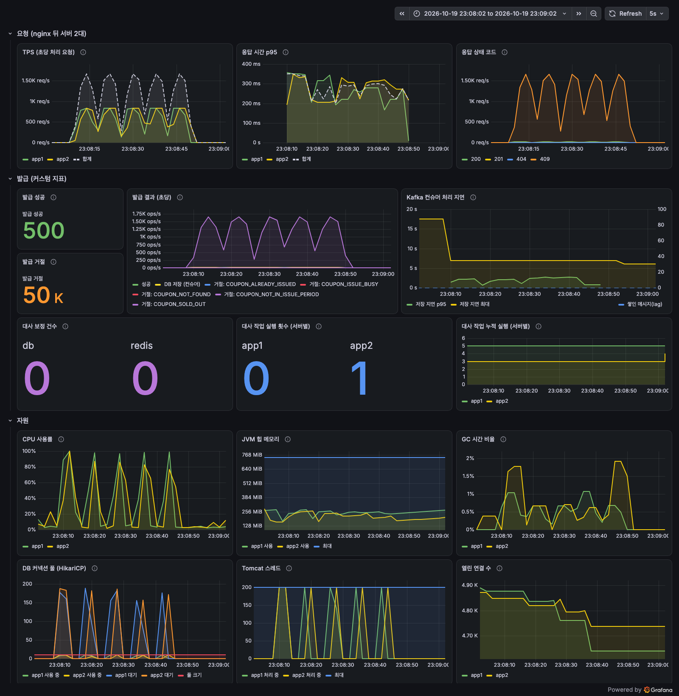
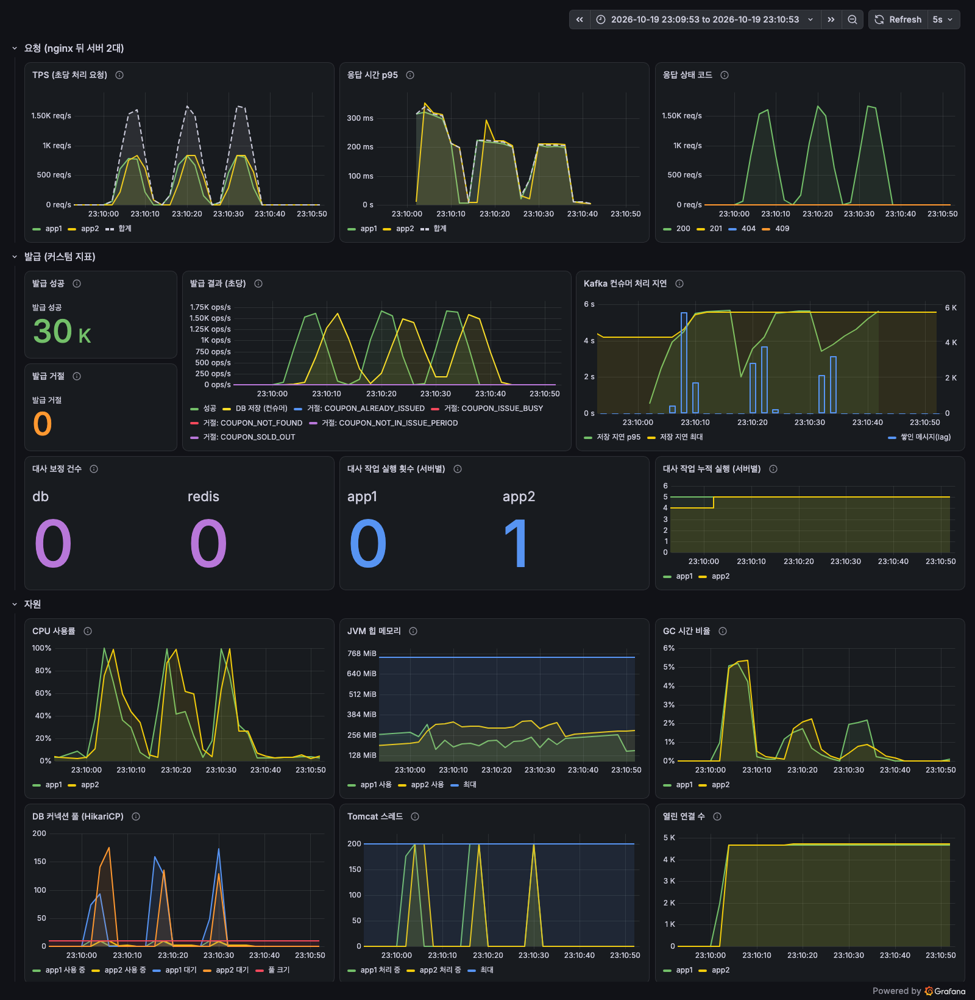
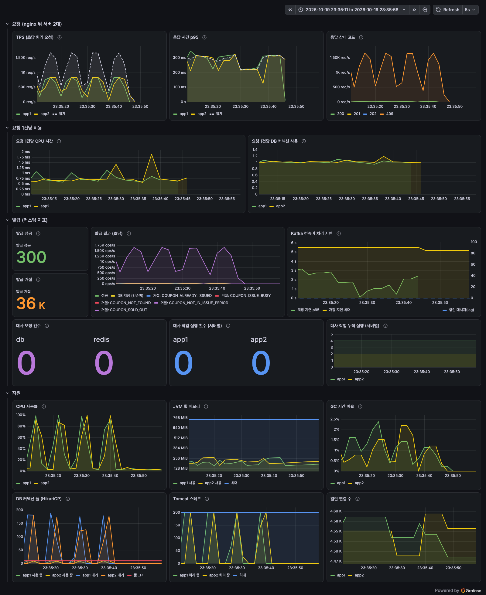
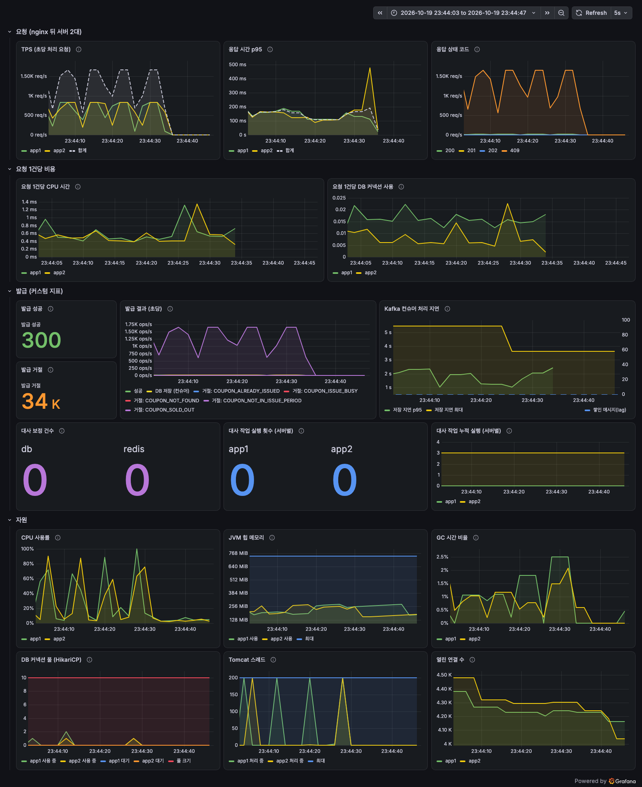

# 선착순 쿠폰 발급 시스템

[](https://github.com/diz99-art/coupon-system/actions/workflows/ci.yml)

**100장짜리 쿠폰에 10,000명이 동시에 몰려도 정확히 100장만, 빠르게 발급하는 백엔드.**
동시성 문제를 직접 재현한 뒤 DB 락 → Redis → Kafka → 서버 2대 → 모니터링 → 캐시 순으로, 단계마다 측정하며 개선했다.

## 기술 스택

- **애플리케이션**: Java 21, Spring Boot 4.1 (Web MVC, Data JPA, Validation, Actuator), springdoc-openapi
- **데이터**: MySQL 8.4, Redis 7 (Lua 스크립트, Redisson 분산 락, ShedLock)
- **메시징**: Kafka 4.3 (KRaft), Spring Kafka (재시도, DLT)
- **인프라·운영**: Docker (멀티 스테이지), docker compose, nginx (로드밸런서), Prometheus, Grafana, GitHub Actions
- **테스트·측정**: JUnit 5, Mockito, Embedded Kafka, k6

## 아키텍처



- **발급 요청 1건**: Redis Lua 스크립트 한 번으로 판정이 끝나고 DB를 쓰지 않는다 (8단계). 발급된 요청만 Kafka로 넘기고 바로 202로 응답한다 (4단계).
- **저장**: 컨슈머가 DB에 저장한다. 실패하면 재시도 후 DLT로 보내고, 같은 메시지가 다시 와도 유니크 제약으로 한 건만 남는다.
- **정합성**: Redis와 DB가 어긋나면 매분 도는 대사 작업이 맞춘다. 서버가 여러 대여도 ShedLock으로 한 서버만 실행한다.

## 핵심 성과

| 항목 | 결과 | 단계 |
|---|---|---|
| 동시성 문제 재현 | 동시성 처리 없이 100장 쿠폰에 1,000명 → **약 1,000장 발급** (수량 컬럼은 100으로 정상처럼 보임) | [1](#1단계-동시성-문제-확인) |
| 정확성 | 최종 방식(Redis Lua + Kafka): 서버 2대, 10,000명 동시 요청에서 **매번 정확히 100장** | [6](#6단계-부하-테스트와-분산-환경) |
| 분산 환경 검증 | 서버 1대에서 정확하던 synchronized가 서버 2대에서 **199~219장 초과 발급** | [6](#6단계-부하-테스트와-분산-환경) |
| 수평 확장 | 서버 1대 → 2대 처리량: Redis Lua + Kafka **2.22배**, DB 비관적 락 1.35배, Redisson 1.06배 | [6](#6단계-부하-테스트와-분산-환경) |
| 응답과 저장 분리 | 1,000장 전원 발급 시 API 응답 **720ms → 450ms** (Kafka 비동기 저장) | [4](#4단계-kafka로-비동기-처리) |
| 병목 분석 | 커넥션 대기 188개가 먼저 보였지만 풀을 4배로 늘려도 처리량 그대로 → **진짜 병목은 CPU**로 판단 | [7](#7단계-운영-준비-스케줄-작업-중복-실행-막기-모니터링) |
| 캐시 | 발급 요청 1건의 SQL **6개 → 0개**, 요청당 CPU **−26%**, 처리량 **2,995 → 4,358 TPS (1.46배)**, p95 **2,185 → 1,067ms** | [8](#8단계-캐시로-cpu-병목-개선) |
| 운영 | 서버 2대에서 동시에 돌던 대사 작업을 ShedLock으로 **매분 한 대만** 실행. 부하 측정 중 정상 발급을 실패로 만들던 대사 작업 버그 발견·수정 | [6](#6단계-부하-테스트와-분산-환경), [7](#7단계-운영-준비-스케줄-작업-중복-실행-막기-모니터링) |
| 테스트 | 실제 MySQL·Redis·Kafka를 쓰는 테스트 **64개**, push·PR마다 GitHub Actions로 실행 | [9](#9단계-포트폴리오-마무리) |

측정은 맥북 한 대의 docker(앱 서버마다 CPU 1개, 메모리 1GB)에서 했다. 절대값보다 방식 사이의 차이를 본다.

## 로컬 실행

```bash
cp .env.example .env                 # 비밀번호 등 환경변수 (git에 올리지 않는다)
docker compose up -d                 # MySQL, Redis, Kafka
./gradlew bootRun                    # http://localhost:8080/swagger-ui.html (local 프로필: 켤 때마다 DB·Redis 초기화)
./gradlew test                       # 테스트 (위 컨테이너가 떠 있어야 한다)
```

서버 2대와 모니터링:

```bash
docker compose --profile cluster up -d --build   # app1·app2, nginx(:8090), Prometheus(:9090), Grafana(:3000)
bench/run.sh 2 10000 REDIS_KAFKA                 # k6로 10,000명 동시 요청 (서버 2대)
```

| 프로필 | 쓰임 |
|---|---|
| `local` (기본) | 개발 서버. 켤 때마다 테이블을 새로 만들고 Redis 쿠폰 키와 Kafka 남은 메시지를 지운다 |
| `test` | 테스트. 전용 Kafka 토픽, 리스너와 스케줄러는 필요한 테스트만 켠다 |
| `docker` | compose의 앱 컨테이너. 접속 주소는 환경변수, 관리용 포트 8081 |
| `bench` | 부하 테스트용 비교 API(`/bench`). prod와 함께 켜면 만들어지지 않는다 |
| `prod` | 배포용. `ddl-auto: validate` + `db/schema.sql`, Swagger 끔, Kafka 복제본 3 (k3s에서는 환경변수로 Swagger 켬, 복제본 1) |

## API

| 메서드 | 주소 | 설명 | 성공 |
|---|---|---|---|
| POST | `/coupons` | 쿠폰 생성 | 201 + Location |
| GET | `/coupons/{couponId}` | 쿠폰 조회 (남은 수량은 Redis 기준) | 200 |
| PUT | `/coupons/{couponId}` | 쿠폰 수정 (발급 판정용 Redis 쿠폰 정보도 함께 바뀜) | 200 |
| POST | `/coupons/{couponId}/issue` | 발급 (Redis 판정 + Kafka 비동기 저장) | 202 |
| GET | `/users/{userId}/coupons` | 내 발급 내역 (최근 순, DB 기준) | 200 |

에러는 모두 같은 형식이다. `errors`는 요청 값 검증에 실패한 필드 목록이고, 그 밖의 에러에서는 빈 배열이다.

```json
{ "code": "COUPON_SOLD_OUT", "message": "쿠폰이 모두 소진되었습니다.", "errors": [] }
```

자세한 요청·응답 형식은 Swagger(`/swagger-ui.html`)에 있다.

## 목차

- [1단계: 동시성 문제 확인](#1단계-동시성-문제-확인)
- [2단계: DB 락으로 해결](#2단계-db-락으로-해결)
- [3단계: Redis로 개선](#3단계-redis로-개선)
- [4단계: Kafka로 비동기 처리](#4단계-kafka로-비동기-처리)
- [5단계: API 정리](#5단계-api-정리)
- [6단계: 부하 테스트와 분산 환경](#6단계-부하-테스트와-분산-환경)
- [7단계: 운영 준비 (스케줄 작업 중복 실행 막기, 모니터링)](#7단계-운영-준비-스케줄-작업-중복-실행-막기-모니터링)
- [8단계: 캐시로 CPU 병목 개선](#8단계-캐시로-cpu-병목-개선)
- [9단계: 포트폴리오 마무리](#9단계-포트폴리오-마무리)
- [트러블슈팅](#트러블슈팅)
- [면접 예상 질문과 답변](#면접-예상-질문과-답변)

## 1단계: 동시성 문제 확인

### 발급 로직 (동시성 처리 없음)

`NoLockCouponIssueService.issue()`는 하나의 트랜잭션 안에서 아래 순서로 처리한다.

1. 쿠폰 조회
2. 발급 기간 확인
3. 발급 수량 < 총 수량 확인
4. 같은 유저의 발급 기록이 있는지 조회
5. 발급 수량 +1, CouponIssue 저장

### 테스트

`CouponIssueConcurrencyTest`는 총 100장짜리 쿠폰에 서로 다른 유저 1,000명이 동시에 발급을 요청한다.

- 스레드 32개(ExecutorService)가 1,000건의 요청을 나눠 처리한다.
- CountDownLatch로 모든 스레드가 준비된 뒤 한꺼번에 출발시키고, 1,000건이 모두 끝날 때까지 기다린다.

### 결과 (3회 실행)

| 회차 | 발급 성공 | 실패 | CouponIssue 저장 건수 | Coupon.issuedQuantity |
|---|---|---|---|---|
| 1 | 992 | 8 | 992 | 100 |
| 2 | 998 | 2 | 998 | 100 |
| 3 | 998 | 2 | 998 | 100 |

100장짜리 쿠폰이 약 1,000장 발급됐다. 그런데 쿠폰의 발급 수량 컬럼은 100으로 정상처럼 보인다.
숫자 컬럼만 봐서는 문제를 알아챌 수 없고, 실제 발급 기록을 세어야 드러난다.

### 원인: 경쟁 조건 (Race Condition)

두 요청 A, B가 동시에 들어오고, 지금 발급 수량이 50이라고 하자.

```
시간   요청 A                         요청 B                         DB의 issued_quantity
 1     쿠폰 조회 → 50 읽음                                            50
 2                                    쿠폰 조회 → 50 읽음              50
 3     50 < 100 확인 → 통과                                            50
 4                                    50 < 100 확인 → 통과             50
 5     51로 UPDATE, 발급 기록 저장                                      51
 6                                    51로 UPDATE, 발급 기록 저장       51  ← A의 +1이 사라짐
```

- 발급 기록은 2건인데 수량은 1만 올랐다. 이것을 **갱신 손실(Lost Update)**이라고 한다.
- 원인은 "읽고 → 확인하고 → 쓰는" 세 단계가 하나로 묶여 있지 않아서, 그 사이에 다른 요청이 끼어들 수 있기 때문이다.
- `@Transactional`만으로는 막을 수 없다. MySQL 기본 격리 수준(REPEATABLE READ)에서 일반 SELECT는 잠금 없이 읽기 때문에, 두 트랜잭션이 같은 값을 동시에 읽는다.
- DB 커넥션 풀(기본 10개) 때문에 약 10개 요청이 같은 값을 읽고 그중 하나만 반영된다.
  그래서 수량이 1 오를 때마다 약 10건이 발급되고, 100이 될 때까지 약 1,000건이 통과했다.
- 중복 발급 확인(4번)도 같은 방식이라 같은 유저가 동시에 요청하면 두 번 발급될 수 있다.

다음 단계에서는 락(비관적·낙관적), Redis, Kafka로 이 문제를 해결하고 결과를 비교한다.

## 2단계: DB 락으로 해결

발급 방법마다 서비스 클래스를 따로 두고, 모두 `CouponIssuer` 인터페이스를 구현해 같은 테스트(`CouponIssueComparisonTest`)로 비교했다.

- `NoLockCouponIssueService`: 1단계 그대로 (비교 기준)
- `SynchronizedCouponIssueService`: 발급 메서드에 `synchronized`
- `PessimisticLockCouponIssueService`: 쿠폰을 `SELECT ... FOR UPDATE`로 잠그고 조회
- `OptimisticLockCouponIssueService`: `Coupon`의 `@Version`으로 충돌을 감지하고, 충돌하면 10ms 쉬고 새 트랜잭션으로 재시도

`Coupon`에 `@Version`을 붙이면 엔티티로 수정하는 모든 코드에 버전 확인이 걸린다.
락 없는 방법과 synchronized 방법은 문제를 그대로 보여주기 위해 버전 확인 없는 UPDATE(`overwriteIssuedQuantity`)로 수량을 덮어쓴다.

### 중복 발급 (같은 유저가 동시에 10번 요청)

- 유니크 제약 없음: 3회 모두 **10건** 발급. "이미 받았는지" 조회도 읽기 → 확인 → 쓰기라서 10개 요청이 모두 "없음"을 본다.
- `CouponIssue`에 (coupon_id, user_id) 유니크 제약 추가 후: **1건**만 발급되고 나머지 9건은 DB가 거절한다.
  API에서는 409 `ALREADY_ISSUED`로 응답한다.

조회 확인은 대부분의 중복을 빨리 거르는 용도이고, 최종 방어선은 DB 유니크 제약이다.

### 비교 결과 (총 100장, 1,000명, 스레드 32개, DB 커넥션 10개, 방법마다 3회)

| 방법 | 발급 건수 (1/2/3회) | 정확도 | 소요 시간 (1/2/3회) | 평균 | 재시도 |
|---|---|---|---|---|---|
| 락 없음 | 973 / 1000 / 999 | ✗ | 1707 / 1321 / 1295ms | 1441ms | - |
| synchronized | 200 / 200 / 200 | ✗ | 578 / 507 / 550ms | 545ms | - |
| 비관적 락 | 100 / 100 / 100 | ✓ | 581 / 487 / 476ms | 515ms | - |
| 낙관적 락 | 100 / 100 / 100 | ✓ | 835 / 784 / 784ms | 801ms | 890 / 890 / 891회 |

- 락 없음이 가장 느린 이유는 100건이 아니라 약 1,000건을 INSERT했기 때문이다.
- 맥북 한 대, 도커 MySQL에서 잰 값이라 절대 시간보다는 방법 사이의 차이를 보면 된다.

### synchronized: 왜 정확히 200장인가

`@Transactional`은 프록시가 처리한다. 스프링은 서비스 객체를 감싼 프록시를 만들고, 호출 흐름은 이렇다.

```
프록시: 트랜잭션 시작
  └ 실제 객체의 synchronized issue() 실행 ← 여기만 한 스레드씩
프록시: 커밋                               ← synchronized 바깥
```

메서드가 끝나 락이 풀린 뒤, 커밋하기 전에 다음 스레드가 들어온다.

1. A가 수량 50을 읽고 51로 UPDATE한 뒤 synchronized를 빠져나간다 (아직 커밋 전).
2. B가 들어와 수량을 읽는다. A가 커밋하지 않았으니 50이 보인다.
3. B가 51로 UPDATE하려 하지만 A가 행을 잠그고 있어서 A의 커밋까지 기다린다. 그동안 B는 synchronized를 쥐고 있다.
4. A 커밋 → B도 51로 덮어쓴다. 같은 값 51을 두 번 쓰면서 발급 기록은 2건이 된다.
5. B가 나간 뒤 C는 A가 커밋한 51을 읽고 52로 쓴다. 다시 1번부터 반복.

수량 1마다 2건씩 발급되어 정확히 200장이 됐다.
synchronized를 트랜잭션 바깥(커밋까지 감싸는 위치)으로 옮기면 한 대에서는 맞출 수 있다.
`SynchronizedOutsideTransactionCouponIssueService`로 확인한 결과 3회 모두 정확히 100장이었다 (3단계 표 참고).
하지만 synchronized는 **한 JVM 안의** 스레드만 막는다. 서버가 2대면 각 서버에 락이 따로 있어서 두 서버의 요청이 동시에 DB에 들어간다.
- 서버가 여러 대일 때: 서버 A와 B가 각자 자기 synchronized를 통과한 요청을 하나씩 동시에 DB로 보내므로, 1단계와 같은 경쟁 조건이 서버 수만큼 다시 생긴다.

### 비관적 락: 실제 SQL과 DB에서 일어나는 일

API를 한 번 호출했을 때 Hibernate가 실행한 SQL:

```sql
select c1_0.id, ..., c1_0.version from coupon c1_0 where c1_0.id=? for update of c1_0
select ci1_0.id from coupon_issue ci1_0 where ci1_0.coupon_id=? and ci1_0.user_id=? limit ?
insert into coupon_issue (coupon_id, issued_at, user_id) values (?, ?, ?)
update coupon set ..., issued_quantity=?, ..., version=? where id=? and version=?
```

- `FOR UPDATE`는 읽은 쿠폰 행에 **배타 락(X 락)**을 건다. 락은 커밋이나 롤백할 때 풀린다.
- 다른 트랜잭션의 `FOR UPDATE`는 그 행 앞에서 기다린다. 그래서 같은 쿠폰의 "읽기 → 확인 → 쓰기"가 한 줄로 차례차례 실행된다.
- 락은 서버가 아니라 DB에 걸리므로 서버가 여러 대여도 동작한다.
- 기다림이 `innodb_lock_wait_timeout`(기본 50초)을 넘으면 실패한다.

### 낙관적 락: 재시도

- 락 없이 읽고, 수정할 때 `UPDATE ... WHERE id = ? AND version = ?`로 그사이 누가 바꿨는지 확인한다. 바뀌었으면 0행이 수정되고 예외가 난다.
- 실패한 트랜잭션은 롤백되므로 재시도는 트랜잭션 **바깥**에서 새 트랜잭션으로 해야 한다 (`OptimisticLockCouponIssueTransaction`을 바깥 서비스가 반복 호출).
- 100장을 발급하는 동안 약 890번 충돌해 다시 시도했다. 커넥션 10개가 같은 버전을 읽으면 그중 하나만 성공하기 때문이다.

### 언제 무엇을 쓰나

- **비관적 락이 유리한 상황**: 충돌이 잦을 때. 선착순 쿠폰처럼 한 행에 요청이 몰리면 줄 세우는 편이 재시도로 버리는 작업보다 싸다.
- **낙관적 락이 유리한 상황**: 충돌이 드물 때. 예를 들어 게시글 수정, 회원 정보 변경. 락을 잡지 않으니 평소에 빠르고, DB 커넥션을 붙잡고 기다리지 않는다.

### 결론

- 이번 상황(한 쿠폰에 1,000명이 동시에)에서는 **비관적 락**이 정확하면서 가장 빨랐다. API는 비관적 락 방식으로 바꿨다 (4단계에서 Kafka 방식으로 다시 바꿈).
- 중복 발급은 락과 별개로 **DB 유니크 제약**으로 막는다.
- 남은 한계: 모든 요청이 DB의 한 행 앞에 줄을 서므로 요청이 더 많아지면 DB 커넥션과 락 대기가 병목이 된다. 다음 단계에서 Redis로 DB 앞단에서 처리한다.

면접 답변은 [면접 예상 질문과 답변](#면접-예상-질문과-답변)에 모았다.

## 3단계: Redis로 개선

Redis를 쓰는 두 방법을 추가하고, 1·2단계 방법까지 모두 한 번에 다시 측정했다.

- `RedissonLockCouponIssueService`: Redisson 분산 락을 쿠폰 id마다 잡고, 안에서 락 없는 DB 발급 로직을 실행
- `RedisCounterCouponIssueService`: Redis Lua 스크립트로 "받은 유저 SET 확인 → 수량 확인 → INCR → SADD"를 한 번에 처리하고, 통과한 요청만 DB에 발급 기록 저장

Redis 연결은 `RedisConnectionTest`로 확인한다 (Spring의 `StringRedisTemplate` PING, 값 저장·조회, Redisson 락 잡기).

### Redisson 분산 락

- **waitTime (10초)**: 락을 얻을 때까지 기다리는 최대 시간. 넘으면 `BUSY`(503)로 거절한다.
  - 너무 짧으면: 정상 요청도 줄을 서다 실패한다. 쿠폰이 남았는데 "실패"를 받는 사용자가 생긴다.
  - 너무 길면: 요청 스레드가 오래 묶여 서버 스레드가 바닥나고, 사용자는 오래 기다린 뒤에야 실패를 받는다.
- **leaseTime (3초)**: 락을 잡은 서버가 죽어도 이 시간이 지나면 락이 저절로 풀린다.
  - 너무 짧으면: 발급이 끝나기 전에 락이 풀려 다른 요청이 들어온다. 다시 초과 발급이 생길 수 있다.
  - 너무 길면: 락을 잡은 서버가 죽었을 때 그 시간 동안 아무도 발급하지 못한다.
  - leaseTime을 주지 않으면 Redisson의 watchdog이 작업이 끝날 때까지 락을 자동으로 연장해 준다.
- **락 해제와 커밋 순서**: 반드시 **커밋 → 락 해제** 순서여야 한다.
  락을 먼저 풀면 synchronized 때처럼 다음 요청이 커밋 전의 옛 수량을 읽는다.
  그래서 이 클래스에는 `@Transactional`을 붙이지 않고, 트랜잭션은 안쪽 서비스(`NoLockCouponIssueService`)에 둔다.
  안쪽 호출이 돌아온 시점에는 이미 커밋됐고, 그 뒤 `finally`에서 락을 푼다.
- 해제할 때 `isHeldByCurrentThread()`를 확인한다. leaseTime이 지나 락이 이미 풀렸고 다른 요청이 새로 잡았다면, 남의 락을 풀면 안 되기 때문이다.

### Redis INCR + SET (Lua 스크립트)

```lua
if redis.call('SISMEMBER', KEYS[1], ARGV[1]) == 1 then return 2 end   -- 이미 받음
local count = tonumber(redis.call('GET', KEYS[2]) or '0')
if count >= tonumber(ARGV[2]) then return 3 end                        -- 매진
redis.call('INCR', KEYS[2])
redis.call('SADD', KEYS[1], ARGV[1])
return 1                                                                -- 발급
```

- Redis는 명령을 한 줄로 하나씩 처리하고, Lua 스크립트 하나는 중간에 다른 명령이 끼어들지 않고 끝까지 실행된다.
- **Lua 없이 따로 실행하면**: 애플리케이션이 `SISMEMBER` → `GET` → `INCR` → `SADD`를 네트워크로 하나씩 보내게 된다. 명령 사이에 다른 요청의 명령이 끼어든다.
  - 수량: 99를 읽은 요청 둘이 모두 "남았다"고 판단해 101장이 된다. 1단계와 같은 문제가 Redis에서 다시 생긴다.
    INCR 결과값으로 판정하면(INCR 후 100 초과면 거절) 수량은 지킬 수 있지만, 중복 확인과 증가가 따로 놀아 같은 유저가 두 자리를 차지할 수 있다.
  - 중복: 같은 유저의 두 요청이 모두 SISMEMBER에서 "없음"을 보고 둘 다 발급된다.
- DB의 `Coupon.issuedQuantity`는 갱신하지 않는다. 갱신하면 다시 한 행에 UPDATE가 몰려 DB 병목이 돌아오기 때문이다. 이 방법에서 수량의 기준은 Redis 카운터다.

### Redis와 DB가 어긋날 수 있는 경우 (해결은 4단계)

- Redis에서 자리를 얻었는데 DB 저장이 실패한다 (DB 장애, 커넥션 부족, 타임아웃). 카운터는 올라갔지만 기록이 없어서 쿠폰이 덜 발급된다.
- Redis 처리 직후 서버가 죽는다. 위와 같이 자리만 차지하고 기록이 남지 않는다.
- Redis 데이터가 사라진다 (재시작, 메모리 부족으로 키 삭제, 영속화 설정 없음). 카운터가 0부터 다시 시작해 초과 발급된다.
- 운영자가 DB에서 발급 기록을 지우거나 쿠폰 총 수량을 바꿨는데 Redis에는 반영되지 않는다.

### 전체 비교 (총 100장, 1,000명, 스레드 32개, DB 커넥션 10개, 방법마다 3회, 한 번에 다시 측정)

| 방법 | 발급 건수 (1/2/3회) | 정확도 | 소요 시간 (1/2/3회) | 평균 | 여러 서버 |
|---|---|---|---|---|---|
| 락 없음 | 976 / 1000 / 1000 | ✗ | 1541 / 1332 / 1246ms | 1373ms | ✗ |
| synchronized (트랜잭션 안) | 200 / 200 / 200 | ✗ | 567 / 535 / 517ms | 540ms | ✗ |
| synchronized (트랜잭션 바깥) | 100 / 100 / 100 | ✓ | 882 / 850 / 945ms | 892ms | ✗ |
| 비관적 락 | 100 / 100 / 100 | ✓ | 601 / 492 / 502ms | 532ms | ✓ |
| 낙관적 락 (재시도 890 / 891 / 887회) | 100 / 100 / 100 | ✓ | 815 / 927 / 957ms | 900ms | ✓ |
| Redisson 분산 락 | 100 / 100 / 100 | ✓ | 1821 / 1777 / 1846ms | 1815ms | ✓ |
| Redis Lua (INCR + SET) | 100 / 100 / 100 | ✓ | 430 / 371 / 359ms | 387ms | ✓ |

- Redis Lua 방법의 정확도는 DB 발급 기록 100건과 Redis 카운터 100으로 확인했다 (DB의 issuedQuantity는 0).
- **Redisson이 가장 느린 이유**: 매진 뒤의 900건을 포함한 1,000건 모두가 락을 하나씩 거쳐 간다.
  락을 잡고 풀 때마다 Redis 왕복이 생기고, 기다리던 요청은 Redis pub/sub 알림을 받고 깨어나는 시간이 더해진다. 락 안에서는 DB 조회와 저장도 그대로 한다.
- **Redis Lua가 가장 빠른 이유**: 줄을 서는 구간이 Redis 안의 스크립트 한 번(마이크로초 단위)뿐이다. 매진 뒤 요청은 DB에 쓰지 않고 바로 거절된다.

### 결론

- 단순히 "정확하게"만 보면 비관적 락으로도 충분하다. 서버 한 대, DB 한 대에서는 Redisson을 덧붙일 이유가 적다.
- Redisson 분산 락은 줄 서는 곳을 DB 커넥션에서 Redis로 옮긴다. 비관적 락은 기다리는 요청이 DB 커넥션을 붙잡고 기다리지만, Redisson은 락을 얻은 요청만 DB 커넥션을 쓴다. DB가 아닌 자원(외부 API 호출 등)을 함께 지켜야 할 때도 쓸 수 있다.
- 트래픽이 큰 선착순 이벤트에는 **Redis Lua** 방식이 가장 알맞다. 판정을 Redis에서 끝내고, DB에는 발급될 100건만 들어간다.
- 대신 Redis와 DB 두 곳에 상태가 생겨서 어긋날 수 있다. 4단계에서 이 문제를 다룬다.

면접 답변은 [면접 예상 질문과 답변](#면접-예상-질문과-답변)에 모았다.

## 4단계: Kafka로 비동기 처리

### Kafka 한 줄 정리

- **Kafka**: 메시지를 디스크에 순서대로 쌓아 두는 분산 로그. 보내는 쪽과 받는 쪽이 서로를 몰라도 되고, 받는 쪽이 느리거나 잠깐 죽어도 메시지가 남아 있다.
- **토픽**: 메시지를 담는 이름 붙은 통. 여기서는 `coupon-issue`(발급)와 `coupon-issue.DLT`(최종 실패).
- **프로듀서**: 토픽에 메시지를 넣는 쪽 (`CouponIssueProducer`, API 서버).
- **컨슈머**: 토픽에서 메시지를 꺼내 처리하는 쪽 (`CouponIssueConsumer`, DB 저장). 같은 그룹 id의 컨슈머들은 메시지를 나눠 가진다.
- **파티션**: 토픽을 나눈 칸. 한 파티션은 그룹 안의 컨슈머 하나만 읽으므로, 파티션 수가 동시에 처리할 수 있는 컨슈머 수의 상한이다.
  메시지 키(여기서는 유저 id)가 같으면 같은 파티션으로 가서 순서가 지켜진다. `coupon-issue`는 파티션 3개, 컨슈머 3개.
- **KRaft**: Kafka가 Zookeeper 없이 스스로 메타데이터를 관리하는 방식. Kafka 4부터는 KRaft만 지원한다.

### 구조

```
                ┌──────────── API 서버 ────────────┐
 요청 ─────────▶│ 1. 쿠폰 조회 (기간, 총 수량)       │
                │ 2. Redis Lua: 중복? 매진? → INCR  │──▶ Redis (받은 유저 SET, 수량)
                │ 3. Kafka로 발급 메시지 전송        │──▶ Kafka [coupon-issue] (파티션 3)
 ◀── 202 ───────│ 4. 바로 응답                       │          │
                └───────────────────────────────────┘          ▼
                                                    컨슈머 3개 (CouponIssueConsumer)
                                                      │ 저장 성공 ──▶ MySQL coupon_issue
                                                      │ 실패 → 1초 간격 3번 재시도
                                                      ▼ 그래도 실패
                                                    Kafka [coupon-issue.DLT] ──▶ 에러 로그

           대사 스케줄러 (1분마다): Redis 받은 유저 SET ⟷ DB coupon_issue 비교, 빠진 쪽 보정
```

- 메시지 전송이 실패하면(브로커 장애, 3초 시간 초과) Redis에서 차지한 자리를 Lua로 되돌리고 503으로 응답한다.
- 기존 `CouponIssuer` 구현체들은 비교용으로 그대로 둔다.

### 실패 처리 흐름

1. 컨슈머가 DB 저장 중 예외 → `DefaultErrorHandler`가 같은 메시지를 **1초 간격으로 3번** 다시 시도 (`coupon.kafka.retry.*`).
2. 4번 모두 실패 → `DeadLetterPublishingRecoverer`가 메시지를 **DLT 토픽**으로 보내고 다음 메시지로 넘어간다. 한 메시지 때문에 파티션 전체가 멈추지 않는다.
3. 이때 Redis에는 발급됨, DB에는 없음 → **대사 작업**이 Redis에만 있는 유저를 찾아 DB에 저장한다.

`KafkaFailureHandlingTest` (내장 Kafka, DB 저장을 Mockito로 일부러 실패시킴) 결과:

- 2번 실패 후 3번째 시도에서 저장 성공 (저장 시도 3번)
- 4번 모두 실패 → 약 2초 뒤 DLT 도착 (테스트에서는 간격 0.3초): `{"couponId":3,"userId":999,"issuedAt":"..."}`
  - 이 시점 Redis에는 999번 유저가 있고 DB에는 없다 → 대사 작업 실행 → `savedToDb=1`, DB에 저장됨
- 같은 메시지를 두 번 보내면 컨슈머가 두 번 처리하지만 DB에는 1건

### 멱등성

같은 작업을 여러 번 해도 결과가 한 번 한 것과 같은 성질. Kafka는 "최소 한 번(at-least-once)" 전달이라 같은 메시지가 다시 올 수 있다.

- 컨슈머가 저장은 했는데 오프셋 커밋 전에 죽으면, 다시 뜬 컨슈머가 같은 메시지를 또 읽는다.
- 컨슈머가 그룹에 들어오고 나가며 **파티션 재배정**이 일어나면 처리 중이던 메시지가 다시 전달된다.
  실제로 테스트를 처음 짰을 때, 재시도 도중 재배정이 일어나 "4번 시도"가 6~7번으로 늘어났다.
- 대사 작업이 아직 처리되지 않은 메시지와 같은 유저를 먼저 저장할 수 있다.

그래서 `CouponIssueSaver`는 (coupon_id, user_id) 유니크 제약에 걸리면 "이미 저장됨"으로 보고 성공 처리한다. 2단계에서 넣은 유니크 제약이 여기서 멱등성의 바탕이 된다.

### 정기 대사 작업 (`CouponReconciliationService`, 1분마다)

- **Redis에만 있음** (메시지가 DLT로 감, 유실): DB에 저장. 원래 발급 시각은 알 수 없어 보정 시각으로 남긴다.
- **DB에만 있음** (Redis 데이터 유실, 전송 시간 초과 후 Redis를 되돌렸는데 메시지는 실제로 도착): Redis SET에 다시 넣고 수량 카운터를 SET 크기에 맞춘다.
- `CouponReconciliationTest`: Redis {1,2,3,4,5}(카운터 5), DB {1,2,3,6}으로 일부러 어긋나게 만든 뒤 대사 → 양쪽 모두 {1,2,3,4,5,6}, 카운터 6. 한 번 더 돌리면 바뀌는 것 없음.

### 측정 (1,000명 동시 요청, 방법마다 3회, docker Kafka)

"API 응답 완료"는 1,000건의 요청이 모두 응답을 받은 시점, "DB 저장 완료"는 발급 기록이 DB에 모두 들어온 시점이다.

| 쿠폰 수량 | 방법 | API 응답 완료 (1/2/3회) | 평균 | DB 저장 완료 (1/2/3회) | 평균 |
|---|---|---|---|---|---|
| 100장 | Redis + DB 동기 저장 (3단계) | 540 / 411 / 393ms | 448ms | 543 / 412 / 394ms | 450ms |
| 100장 | Redis + Kafka 비동기 저장 | 518 / 473 / 396ms | 462ms | 570 / 497 / 428ms | 498ms |
| 1,000장 | Redis + DB 동기 저장 (3단계) | 729 / 703 / 727ms | 720ms | 731 / 705 / 728ms | 721ms |
| 1,000장 | Redis + Kafka 비동기 저장 | 396 / 538 / 415ms | 450ms | 984 / 1153 / 1088ms | 1075ms |

- **100장**: 900명은 Redis에서 바로 거절되고 DB 쓰기는 100건뿐이라 차이가 거의 없다. Kafka 쪽은 요청마다 브로커 응답(acks=all)을 기다리는 시간이 DB INSERT 시간과 비슷하다.
- **1,000장(전원 발급)**: DB 쓰기가 많아지자 Kafka 방식의 API 응답이 약 **37% 빨라졌다**(720 → 450ms). 대신 DB에 모두 들어오기까지는 더 오래 걸린다(1075ms). 컨슈머 3개가 한 건씩 저장하기 때문이다.
- 결국 Kafka는 "전체 처리를 빠르게"가 아니라 **"사용자 응답을 DB에서 떼어내는"** 도구다. DB가 느려지거나 잠깐 죽어도 API는 계속 응답하고, 메시지는 Kafka에 쌓여 있다가 DB가 돌아오면 저장된다.

### 남은 한계

- 응답 직후 잠깐은 DB에 기록이 없다 (최종 일관성). "내 쿠폰 목록"을 바로 조회하면 안 보일 수 있다.
- 대사 작업으로 채운 발급은 원래 발급 시각이 아니다. 필요하면 Redis에 유저별 발급 시각(Hash)을 함께 둔다.
- 대사 작업이 쿠폰 전체를 매번 비교한다. 쿠폰이 많아지면 진행 중이거나 막 끝난 쿠폰만 보도록 줄여야 한다.
- 메시지 전송 성공과 Redis 차감이 하나의 트랜잭션이 아니다. 전송 시간 초과처럼 결과를 모르는 경우는 대사 작업이 사후에 맞춘다.

면접 답변은 [면접 예상 질문과 답변](#면접-예상-질문과-답변)에 모았다.

## 5단계: API 정리

### 4단계 문제 수정

- **개발 환경 초기화**: `local` 프로필(기본 프로필)에서 서버를 켜면 DB 테이블을 새로 만들고(`ddl-auto: create`), `LocalRedisInitializer`가 Redis의 `coupon:*` 키도 지운다.
  빈이 만들어질 때 실행되므로 Kafka 리스너와 대사 스케줄러가 시작되기 전에 끝난다. 키는 `KEYS` 대신 `SCAN`으로 찾아 Redis를 오래 막지 않는다.
  기본 설정(`application.yml`)은 `ddl-auto: none`이고, 개발(`application-local.yml`)과 테스트에서만 `create`를 쓴다.
- **SET → Sorted Set**: 받은 유저를 `coupon:{id}:users` Sorted Set에 넣고 score에 발급 시각(epoch 밀리초)을 저장한다.
  Lua 스크립트는 `SISMEMBER` → `ZSCORE`, `SADD` → `ZADD`, `SREM` → `ZREM`, `SCARD` → `ZCARD`로 바꿨다.
  발급 시각은 밀리초까지만 써서 Redis score와 DB 값이 정확히 같다.
- **대사 작업**: Redis에만 있는 발급은 Redis의 원래 발급 시각으로 DB에 저장하고, DB에만 있는 발급은 DB의 발급 시각으로 Redis에 넣는다.
  `CouponReconciliationTest`에서 유저마다 다른 시각으로 어긋나게 만든 뒤, 대사 후 양쪽의 (유저, 발급 시각)이 완전히 같은지 확인한다.
- **테스트 환경**: 테스트는 `test` 프로필과 테스트 전용 Kafka 토픽(`coupon-issue-test`)을 쓴다.
  DB와 Redis를 쓰는 테스트는 `IntegrationTest`를 상속하고, 테스트마다 **시작 전과 끝난 뒤** 발급 기록, 쿠폰, Redis 쿠폰 키를 지운다.
  시작 전 정리는 지난 테스트가 중간에 죽어 남긴 데이터를, 끝난 뒤 정리는 다음 테스트와 개발 서버에 남길 데이터를 막는다.

### 예외 처리

상황마다 예외 클래스를 두고(`CouponNotFoundException`, `CouponNotInIssuePeriodException`, `CouponSoldOutException`, `CouponAlreadyIssuedException`, `CouponIssueBusyException`), 모두 `CouponException`을 상속한다.
`GlobalExceptionHandler`(`@RestControllerAdvice`) 한 곳에서 `{code, message, errors}` 형식으로 바꾼다.
도메인 예외는 HTTP를 모르고, 상태 코드는 컨트롤러 계층에서 정한다.

| 상황 | code | 상태 | 고른 이유 |
|---|---|---|---|
| 요청 값 검증 실패, JSON·날짜 형식 오류, id가 숫자가 아님 | `INVALID_REQUEST` | 400 | 클라이언트가 요청을 고쳐야만 성공할 수 있다. |
| 쿠폰 없음 | `COUPON_NOT_FOUND` | 404 | 주소가 가리키는 자원이 없다. |
| 발급 기간 아님 | `COUPON_NOT_IN_ISSUE_PERIOD` | 409 | 요청은 올바른데 쿠폰의 지금 상태와 맞지 않는다. 같은 요청이 시작 시각 뒤에는 성공하므로 요청 오류(400)가 아니다. |
| 수량 소진 | `COUPON_SOLD_OUT` | 409 | 요청은 올바른데 남은 수량이라는 자원 상태와 충돌한다. |
| 중복 발급 | `COUPON_ALREADY_ISSUED` | 409 | 이미 만들어진 발급 기록과 충돌한다. |
| 락 대기 초과, Kafka 전송 실패 | `COUPON_ISSUE_BUSY` | 503 + `Retry-After: 1` | 서버 쪽 일시적인 문제라 잠시 뒤 다시 하면 된다. |
| 그 밖의 예외 | `INTERNAL_ERROR` | 500 | 내용은 로그에만 남기고 응답에는 넣지 않는다 (내부 정보 노출 방지). |

- 409 세 가지는 상태 코드가 같아서 클라이언트는 `code`로 구분한다. 화면에서 "매진", "이미 받음", "아직 시작 전"을 다르게 보여줄 수 있다.
- 대안도 검토했다. 기간 밖을 400으로 두는 곳도 많지만 요청 자체는 틀리지 않았다. 403은 권한 문제로 오해된다. 422는 "본문 내용이 의미상 틀림"에 더 가깝다.
- 없는 주소(404), 허용되지 않은 메서드(405)처럼 스프링이 상태를 정해 둔 예외는 그 상태를 그대로 쓰되 같은 형식으로 응답한다.

### 요청 값 검증 (`spring-boot-starter-validation`)

- 쿠폰 생성: 이름 공백 불가·100자 이하, 총 수량 1 이상 1,000,000 이하, 시작·종료 시각 필수, 종료가 시작보다 늦을 것(`@AssertTrue`로 두 필드를 함께 검사).
- 발급: `userId` 필수, 1 이상.
- 틀린 필드를 한 번에 모두 `errors`로 알려준다.

### API 문서

`springdoc-openapi-starter-webmvc-ui` 3.1.1. 서버 실행 후 http://localhost:8080/swagger-ui.html 에서 요청을 직접 보내 볼 수 있다. 문서 JSON은 `/v3/api-docs`.

### 테스트 (`CouponApiTest`, 19개)

- 생성: 201과 Location, 수량 0, 종료가 시작보다 빠름, 여러 필드 동시 오류, 날짜 형식 오류
- 조회: Redis 기준 남은 수량, 없는 쿠폰 404, 숫자가 아닌 id 400
- 발급: 202, 중복 409, 매진 409, 기간 전 409, 없는 쿠폰 404, userId 없음 400, Kafka 전송 실패 시 503 + Retry-After + Redis 되돌림
- 내 발급 내역: 최근 순 정렬과 쿠폰 이름, 빈 목록
- 없는 주소 404 형식, Swagger 문서와 화면

Kafka 전송은 `@MockitoBean`으로 바꿔서 테스트가 메시지를 실제로 보내지 않는다.

면접 답변은 [면접 예상 질문과 답변](#면접-예상-질문과-답변)에 모았다.

## 6단계: 부하 테스트와 분산 환경

### 준비

- **개발 환경 정리 보완**: local 프로필로 켤 때 Redis 쿠폰 키에 더해 Kafka 발급 토픽(과 DLT)의 남은 메시지도 지운다 (`LocalDevDataInitializer`, AdminClient의 `deleteRecords`).
  처리되지 않은 메시지 3건을 일부러 남기고 켰을 때 모두 지워지고 DB에 들어가지 않는 것을 확인했다.
- **비교용 API** (`BenchController`, bench 프로필 전용): `POST /bench/coupons/{id}/issue?method=PESSIMISTIC_LOCK` 처럼 방식을 골라 발급하고, `GET /bench/coupons/{id}/result`로 DB 발급 건수와 Redis 카운터를 본다.
  bench 프로필이 아니면 빈이 아예 만들어지지 않아 404이고 Swagger에도 나오지 않는다 (테스트로 확인). 응답 헤더 `X-Server-Id`로 어느 서버가 처리했는지 알 수 있다.
- **k6**: `brew install k6`로 설치하면 `k6 run bench/issue.js`로 직접 돌릴 수 있다.
  측정은 같은 버전의 k6 컨테이너(`grafana/k6:2.3.0`)를 compose 네트워크 안에서 돌린다 (`bench/run.sh`). 아래 "측정 환경에서 겪은 문제" 참고.

### Docker 이미지와 서버 2대

- `Dockerfile` 멀티 스테이지: JDK 이미지에서 jar를 빌드하고 층(의존성 / 스프링 로더 / 내 코드)으로 풀어, JRE alpine 이미지에 결과만 복사한다. 실행은 root가 아닌 사용자로 한다.
  - 이미지 크기: 레이어 합계 **313MB** (gzip 압축 약 163MB). 빌드용 JDK 이미지만 524MB라서 한 단계로 만들었다면 600MB가 넘는다.
  - 내 코드 층은 365KB뿐이라, 코드만 바꾸면 이 층만 다시 받으면 된다 (의존성 층 99MB는 캐시).
- `docker compose --profile cluster up -d --build`: app1, app2 (각 CPU 1개, 메모리 1GB), nginx.
  - nginx `8090` → 서버 2대(라운드 로빈), `8091` → 서버 1대(app1). 같은 nginx를 거치므로 서버 수만 다르다.
  - 컨테이너는 `docker` 프로필: 서비스 이름(mysql, redis, kafka:29092)으로 접속, `ddl-auto: update`, 전용 Kafka 토픽 `coupon-issue-cluster`.
  - Kafka는 내 컴퓨터용(localhost:9092)과 컨테이너용(kafka:29092) 접속 주소를 따로 둔다.
- **요청 분배 확인**: nginx 로그에 처리한 서버 주소(`upstream=`)를 남긴다. 서버 2대 10,000명 측정에서 app1 4,999건 / app2 5,001건처럼 고르게 나뉘었고, k6가 센 응답 헤더 `X-Server-Id`와 일치했다.
  요청을 한 개씩 순서대로 보내면 14:6처럼 치우칠 수 있다. nginx 작업 프로세스가 여러 개이고 각자 따로 번갈아 보내기 때문이다.

### 측정 방법

- 쿠폰 100장, 동시 사용자 1,000명과 10,000명. 사용자마다 한 번씩 요청 (k6 `shared-iterations`).
- 방식 7개 × 서버 1대/2대 × 3회, 중앙값. 서버 1대와 2대를 번갈아 돌린다 (`bench/all.sh`, 원본 결과는 `bench/results/raw/`).
- 시작 전에 모든 방식을 한 번씩 돌려 **JIT 워밍업**을 한다. 같은 조건에서도 첫 실행은 94 TPS, 네 번째는 302 TPS였다.
- TPS = 전체 요청 수 / 측정 시간. "실제 발급"은 서버의 DB 발급 기록 수 (Kafka 방식은 DB 저장이 끝날 때까지 기다린 뒤 센다).

### 결과
### 동시 사용자 1,000명 (쿠폰 100장, 3회 중앙값)

| 방식 | 서버 | TPS | 평균 응답(ms) | p95(ms) | 실제 발급 (3회) | 오류 응답 |
|---|---|---|---|---|---|---|
| 락 없음 | 1대 | 877 | 542 | 1021 | 998/1000/1000 | 0 |
| 락 없음 | 2대 | 847 | 558 | 982 | 1000/1000/1000 | 0 |
| synchronized (트랜잭션 바깥) | 1대 | 1260 | 366 | 599 | 100/100/100 | 0 |
| synchronized (트랜잭션 바깥) | 2대 | 1244 | 435 | 606 | 199/199/219 | 0 |
| 비관적 락 | 1대 | 1552 | 273 | 502 | 100/100/100 | 0 |
| 비관적 락 | 2대 | 1479 | 409 | 519 | 100/100/100 | 0 |
| 낙관적 락 | 1대 | 912 | 765 | 1005 | 100/100/100 | 0 |
| 낙관적 락 | 2대 | 600 | 1401 | 1568 | 100/100/100 | 0 |
| Redisson 분산 락 | 1대 | 955 | 570 | 933 | 100/100/100 | 0 |
| Redisson 분산 락 | 2대 | 845 | 620 | 1016 | 100/100/100 | 0 |
| Redis Lua (동기 저장) | 1대 | 1786 | 263 | 461 | 100/100/100 | 0 |
| Redis Lua (동기 저장) | 2대 | 1259 | 333 | 499 | 100/100/100 | 0 |
| Redis Lua + Kafka | 1대 | 1215 | 452 | 643 | 100/100/100 | 0 |
| Redis Lua + Kafka | 2대 | 1810 | 203 | 335 | 100/100/100 | 0 |

### 동시 사용자 10,000명 (쿠폰 100장, 3회 중앙값)

| 방식 | 서버 | TPS | 평균 응답(ms) | p95(ms) | 실제 발급 (3회) | 오류 응답 |
|---|---|---|---|---|---|---|
| 락 없음 | 1대 | 904 | 7529 | 9610 | 990/999/1000 | 0 |
| 락 없음 | 2대 | 1807 | 3154 | 4459 | 1994/1995/2000 | 0 |
| synchronized (트랜잭션 바깥) | 1대 | 1589 | 3113 | 5073 | 100/100/100 | 0 |
| synchronized (트랜잭션 바깥) | 2대 | 2835 | 1557 | 2355 | 199/200/204 | 0 |
| 비관적 락 | 1대 | 1408 | 3516 | 6210 | 100/100/100 | 0 |
| 비관적 락 | 2대 | 1898 | 2332 | 3675 | 100/100/100 | 0 |
| 낙관적 락 | 1대 | 1391 | 3412 | 5704 | 100/100/100 | 0 |
| 낙관적 락 | 2대 | 1115 | 3566 | 4880 | 100/100/100 | 0 |
| Redisson 분산 락 | 1대 | 791 | 6274 | 10991 | 100/100/100 | 0 |
| Redisson 분산 락 | 2대 | 836 | 5861 | 10158 | 100/100/100 | 0 |
| Redis Lua (동기 저장) | 1대 | 1686 | 2793 | 4741 | 100/100/100 | 0 |
| Redis Lua (동기 저장) | 2대 | 3588 | 1042 | 1854 | 100/100/100 | 0 |
| Redis Lua + Kafka | 1대 | 1363 | 3156 | 5121 | 100/100/100 | 0 |
| Redis Lua + Kafka | 2대 | 3026 | 1307 | 2522 | 100/100/100 | 0 |

10,000명에서 서버 2대의 TPS 배율: Redis Lua + Kafka **2.22배**, Redis Lua **2.13배**, 락 없음 1.99배, synchronized 1.78배, 비관적 락 **1.35배**, Redisson **1.06배**, 낙관적 락 **0.80배**.

### 분석

- **synchronized는 서버 2대에서 초과 발급된다**: 3회 모두 199~219장. 서버마다 따로 줄을 세우니 두 서버가 동시에 같은 수량을 읽는다. 서버 1대에서는 3회 모두 정확히 100장이었다.
- **락 없음**은 서버 1대에서 약 1,000장, 2대에서 약 2,000장. 서버마다 DB 커넥션 10개가 같은 값을 읽기 때문에 커넥션 수에 비례해 초과된다.
- 나머지 다섯 방식은 서버 2대에서도 **84번 측정 모두 정확히 100장**, 오류 응답 0건.
- **서버를 늘려도 빨라지지 않는 방식**: 공유 자원 하나 앞에 모든 요청이 줄을 서는 방식이다.
  - 비관적 락(1.35배): 쿠폰 한 행의 DB 락에서 줄을 선다.
  - Redisson(1.06배): Redis 락 하나에서 줄을 서고, 락을 잡고 풀 때마다 네트워크 왕복이 생긴다.
  - 낙관적 락(0.80배): 서버가 늘면 같은 버전을 읽는 요청이 늘어 충돌과 재시도가 더 많아진다.
- **서버 수만큼 빨라지는 방식**: Redis Lua는 Redis 안에서 마이크로초 단위로 판정이 끝나서 줄 서는 구간이 거의 없다. 병목이 앱 서버 CPU라 서버를 늘리면 그대로 빨라진다.
- **1,000명에서는 차이가 작다**: 요청 1,000개가 1초 안에 끝나서 연결을 맺는 비용과 측정 오차가 더 크다. 서버 2대가 오히려 느린 경우도 있었다.
- Kafka 방식이 Redis Lua 동기 저장보다 조금 느린 것은 4단계와 같은 이유다. 실제 DB 저장은 100건뿐이고, 요청마다 Kafka 응답(acks=all)을 기다린다.

### 측정 환경에서 겪은 문제

- **대사 작업이 정상 요청을 "이미 발급"으로 만든 버그**: 측정 중 k6는 성공 88건, DB는 100건이었다.
  1분마다 도는 대사 작업이 "Redis 판정 통과 → DB 저장" 사이에 끼어들어 먼저 저장했고, 원래 요청은 중복으로 409를 받았다. 쿠폰을 받은 사람에게 실패 응답이 간 것이다.
  5단계에서 넣은 Redis 발급 시각을 써서, **발급 후 30초(`coupon.reconcile.grace-ms`)가 지나지 않은 기록은 대사하지 않도록** 고쳤다 (테스트 추가).
- **k6를 내 컴퓨터에서 돌리면** Docker Desktop의 포트 전달 구간이 먼저 병목이 되어 서버 1대와 2대 차이가 보이지 않았다. 그래서 k6를 compose 네트워크 안의 컨테이너로 돌린다.
- **서버 1대 10,000명에서 502가 1,944건** 났다. nginx 로그: `connect() failed (99: Address not available)`.
  nginx가 app1 한 주소로 연결을 수만 개 여닫는 동안, 닫힌 연결(TIME_WAIT)이 출발 포트를 붙잡아 포트가 바닥났다.
  앱의 한계가 아니라 측정 환경의 한계라서, nginx와 k6 컨테이너의 포트 범위를 넓히고(`ip_local_port_range`) 재사용(`tcp_tw_reuse`)을 켠 뒤 다시 측정했다.

### 결론

- 서버를 여러 대로 늘리면 **JVM 안의 락(synchronized)은 정확성을 잃는다**. 락은 DB나 Redis처럼 서버들이 함께 보는 곳에 있어야 한다.
- 정확성만 보면 DB 락, Redisson, Redis Lua 모두 서버 2대에서 맞았다. 차이는 **확장성**이다. 공유 자원 앞에 줄을 세우는 방식은 서버를 늘려도 거의 빨라지지 않는다.
- 선착순처럼 한 자원에 요청이 몰리는 경우에는, 줄 서는 구간을 가장 짧게 만드는 **Redis Lua 원자 연산**이 서버를 늘린 만큼 빨라졌다. DB 저장을 응답에서 떼어 내야 하는 경우에는 Kafka를 더한다.

면접 답변은 [면접 예상 질문과 답변](#면접-예상-질문과-답변)에 모았다.

## 7단계: 운영 준비 (스케줄 작업 중복 실행 막기, 모니터링)

### 대사 작업이 서버 2대에서 동시에 돈다

대사 작업을 `@Scheduled`로 돌리면 **서버마다 따로** 실행된다. 대사 작업은 서버가 몇 대든 매분 같은 시각에 깨어나도록 `fixedDelay`에서 cron(`0 * * * * *`)으로 바꿨다.
시작·끝 로그를 남기고 서버 2대에서 확인했다 (`bench/reconcile-check.sh`, 원본은 `bench/results/shedlock/before.txt`).

```
app1 13:55:00.007  대사 작업 시작
app2 13:55:00.010  대사 작업 시작        ← 3ms 차이로 두 서버가 함께 시작
app1 13:55:00.411  대사 보정: DB에 저장 5건, Redis에 복구 0건
app1 13:55:00.412  대사 작업 끝: 405ms, DB 저장 5건
app2 13:55:00.526  대사 작업 끝: 515ms, DB 저장 0건
13:55  실행 2대: app1 app2
13:56  실행 2대: app1 app2
```

이번에는 app2가 app1의 저장 뒤에 DB를 읽어서 결과가 맞았지만, 순서는 그때그때 다르다. 저장이 멱등이라 데이터는 깨지지 않아도 문제가 남는다.
- 같은 작업을 서버 수만큼 해서 DB와 Redis 부하가 그만큼 늘어난다.
- 두 서버가 같은 빈 자리를 함께 보고 보정하면 보정 건수와 경고 로그가 두 배로 잡힌다.
- 알림 발송이나 정산처럼 멱등이 아닌 작업이었다면 두 번 실행된다.

### ShedLock으로 한 서버만 실행

`@SchedulerLock`을 붙이면, 작업 직전에 공유 저장소에 락을 잡은 서버만 실행하고 나머지는 건너뛴다 (`SchedulingConfig`, `ReconciliationScheduler`).
- 락 저장소는 **Redis** (`shedlock-provider-redis-spring`, 키 `job-lock:coupon:couponReconciliation`, `SET NX PX`). 이미 쓰고 있어서 테이블을 따로 만들 필요가 없다.
  대사 작업 자체가 Redis를 읽으므로 Redis가 죽으면 락이 없어도 어차피 할 수 없는 작업이다.
- 락을 못 잡은 서버는 `Not executing 'couponReconciliation'. It's locked.`를 남긴다 (DEBUG 로그를 켰다).
- Redisson 락과 다른 점: Redisson은 "기다렸다가 차례대로 실행"하고, ShedLock은 "누가 하고 있으면 **건너뛴다**". 스케줄 작업은 한 번만 하면 되니 기다릴 필요가 없다.

**유지 시간을 정한 방법** (1분마다 실행, 실제 소요 시간 13~515ms)

- `lockAtMostFor = 50s`: 락을 쥔 서버가 작업 중에 죽으면 락을 풀지 못한다. 이 시간이 지나면 키가 만료돼 다른 서버가 이어받는다.
  - **실행 간격(60초)보다 짧게**: 죽은 서버의 락 때문에 다음 회차까지 건너뛰지 않게 한다.
  - **가장 긴 실행 시간보다 충분히 길게**: 작업이 아직 도는데 락이 풀리면 다른 서버가 끼어든다. 지금은 0.5초 이하라 여유가 100배다. 쿠폰이 많아져 수십 초 걸리게 되면 이 값과 실행 간격을 함께 늘린다.
- `lockAtLeastFor = 10s`: 작업이 13ms 만에 끝나도 10초 동안은 락을 쥐고 있는다.
  - 서버 시계가 조금씩 다르면, 시계가 늦은 서버는 앞 서버가 **이미 끝내고 락을 푼 뒤에** 깨어나 같은 회차를 또 실행할 수 있다. 10초는 서버 간 시계 차이(보통 1초 미만)보다 넉넉하다.
  - 다음 실행(60초 뒤)을 막지 않을 만큼 짧다.

**확인**
- 서버 2대 (`bench/reconcile-check.sh 3`, `bench/results/shedlock/after.txt`): 3분 동안 매분 한 대만 실행했고, 다른 서버는 같은 순간에 `It's locked`로 건너뛰었다. 어느 서버가 실행할지는 그때그때 다르다.
  ```
  14:03  실행 1대: app1    (app2: Not executing ... It's locked)
  14:04  실행 1대: app1    (app2: Not executing ... It's locked)
  14:05  실행 1대: app2    (app1: Not executing ... It's locked)
  app1 Locked 'couponReconciliation', lock will be held at most until 14:03:50
  app1 Task finished, lock 'couponReconciliation' will be released at 14:03:10   ← 0.2초에 끝났지만 10초까지 유지
  ```
- 테스트 (`ReconciliationSchedulerLockTest`, 스레드 2개를 서버 2대로 본다. 락이 Redis에 있어서 다른 서버와 똑같이 다툰다)
  - 두 서버가 동시에 실행하면 대사 서비스는 1번만 불리고, 로그에 "대사 작업 시작" 1번과 `It's locked`가 남는다.
  - 작업이 금방 끝나도 곧바로 깨어난 두 번째 서버는 실행하지 못한다 (lockAtLeastFor). 락 키의 남은 시간이 10초 이하다.
  - 죽은 서버가 남긴 락은 만료된 뒤 다른 서버가 실행한다 (lockAtMostFor).

### 모니터링: Actuator, Micrometer, Prometheus, Grafana

```
app1:8081 ─┐  /actuator/prometheus     Prometheus(:9090)       Grafana(:3000)
app2:8081 ─┴──────────────────────────▶ 2초마다 가져와 저장 ───▶ 대시보드 "쿠폰 발급 시스템"
```

- `spring-boot-starter-actuator` + `micrometer-registry-prometheus`: JVM, HTTP 요청, HikariCP, Tomcat, Kafka 클라이언트 지표가 자동으로 나온다.
- docker 프로필에서는 관리용 주소를 **8081 포트로 분리**했다. nginx는 8080만 넘기므로 밖에서 `/actuator`가 보이지 않는다 (8090으로 요청하면 404).
- HTTP 응답 시간은 **히스토그램**으로도 내보낸다 (`percentiles-histogram`). 서버마다 p95를 따로 계산하면 두 서버의 p95를 합칠 수 없지만, 구간별 개수는 더할 수 있어서 Grafana에서 서버 2대 전체의 p95를 낸다.
- `docker compose --profile cluster up -d --build`로 앱 2대, nginx와 함께 Prometheus, Grafana가 뜬다. Grafana는 데이터 소스와 대시보드를 파일에서 자동으로 불러온다.
  - `monitoring/prometheus/prometheus.yml`: 수집 대상 app1:8081, app2:8081
  - `monitoring/grafana/provisioning/`: 데이터 소스와 대시보드 폴더 등록
  - `monitoring/grafana/dashboards/coupon.json`: 대시보드 (`monitoring/grafana/gen_dashboard.py`로 만든다)
  - http://localhost:3000 은 로그인 없이 볼 수 있다 (편집은 admin/admin).

**커스텀 지표** (`CouponMetrics`)

| 지표 | 종류 | 기록하는 곳 |
|---|---|---|
| `coupon_issue_success_total` | 카운터 | 발급 API에서 Redis 판정 통과와 Kafka 전송까지 마쳤을 때 |
| `coupon_issue_rejected_total{reason}` | 카운터 | 거절 사유별 (`COUPON_SOLD_OUT`, `COUPON_ALREADY_ISSUED`, ...). 0이어도 그래프에 나오도록 미리 등록 |
| `coupon_issue_save_delay_seconds` | 타이머(히스토그램) | 컨슈머가 DB에 저장한 시각 − 발급 확정 시각. Kafka 컨슈머 처리 지연 |
| `coupon_reconcile_corrected_total{target}` | 카운터 | 대사 작업이 채운 건수 (`db`: DB에 저장, `redis`: Redis에 복구) |
| `coupon_reconcile_duration_seconds` | 타이머 | 대사 작업 시간. 서버별 실행 횟수(`_count`)로 ShedLock이 한 대만 돌리는지 본다 |

토픽에 쌓인 메시지 수(lag)는 Kafka 클라이언트 지표 `kafka_consumer_fetch_manager_records_lag`를 쓴다.

**대시보드 패널**: TPS(서버별·합계), p95 응답 시간, 상태 코드 / 발급 성공·거절 사유·컨슈머 저장 속도, Kafka 처리 지연과 lag, 대사 보정 건수와 서버별 실행 / CPU, JVM 힙, GC 시간, DB 커넥션 풀, Tomcat 스레드, 열린 연결 수.
"발급 성공" 같은 기간 합계는 `increase()` 대신 `max_over_time − min_over_time`으로 센다. `increase()`는 구간 양 끝을 추정으로 늘려서 실제 500건이 514건으로 나왔다.

### 부하 중 대시보드 (Redis + Kafka, 서버 2대, 10,000명)

`bench/monitor.sh <반복 횟수> [쿠폰 수량]`: 10,000명 시나리오를 여러 번 이어 보내고, 그 구간의 대시보드를 headless Chrome으로 캡처한다.
한 번이 3초 남짓이라 그래프에 점 몇 개뿐이어서 5번 이어 보냈다. 측정 전에 9번 돌려 JIT 워밍업을 했다 (첫 번째 1,322 TPS → 아홉 번째 2,969 TPS).

**① 쿠폰 100장, 10,000명 × 5회** (k6: TPS 2,491~3,385, 중앙값 3,082, p95 중앙값 2.3초, 매회 정확히 100장)



**② 쿠폰 10,000장, 10,000명 × 3회**: 모두 발급되어 Kafka와 DB 저장까지 부하가 간다 (k6: TPS 2,267~3,286, 매회 DB 10,000건)



### 어떤 지표가 먼저 한계에 닿나

요청이 몰리는 순간 (Prometheus 2초 간격 값 중 최대, ① 기준):

| 지표 | 최대 | 한계 |
|---|---|---|
| CPU 사용률 | **100%** | 서버당 CPU 1개 |
| DB 커넥션 사용 중 | **10** | 풀 10개 |
| DB 커넥션 대기 스레드 | **188** | - |
| 커넥션 얻기까지 평균 / 최대 | 109ms / 4.9초 | - |
| Tomcat 처리 중 스레드 | **200** | 200개 |
| 열린 연결 | 4,889 | 20,000 |
| JVM 힙 | 281MB | 768MB |
| GC 시간 비율 | 1.9% | - |

- 처음 보이는 경보는 **DB 커넥션 풀**이다. 커넥션 10개가 모두 쓰이고 스레드 188개가 기다린다. 그 바람에 Tomcat 스레드 200개가 다 차고, 나머지 연결 수천 개는 차례를 기다린다.
  - 발급 API가 DB를 쓰는 곳은 쿠폰 조회(`findById`, 기간과 총 수량 확인) 하나뿐인데도 요청마다 커넥션을 잡는다.
- 하지만 **진짜 한계는 CPU**였다. 풀을 10 → 40으로 늘려 같은 조건으로 다시 쟀다 (`docs/images/grafana-pool40.png`).
  - TPS는 늘지 않았다 (중앙값 3,082 → 2,478). 대기 스레드도 188 → 145로 거의 그대로였다.
  - 커넥션 하나를 쥐고 있는 시간이 7.8ms → 33.8ms로 **커넥션 수만큼 늘었다**. 기본 키 조회는 1ms도 안 걸리는 일인데, 커넥션을 쥔 스레드가 CPU 차례를 기다리느라 오래 쥐고 있는 것이다.
  - 즉 CPU 1개를 스레드 200개가 나눠 쓰는 것이 병목이고, 커넥션 풀 대기는 그 결과가 가장 먼저 드러난 증상이다. 메모리(힙 37%)와 GC(2% 이하)는 여유가 있었다.
- **서버가 잰 응답 시간과 사용자가 겪은 응답 시간이 다르다**: 서버 p95는 0.35초인데 k6 p95는 2.3초다. 서버 지표는 Tomcat 스레드가 요청을 잡은 뒤부터 재기 때문에, 스레드가 비기를 기다린 시간이 빠진다. 열린 연결 수와 Tomcat 스레드가 함께 차 있으면 이 대기가 있다는 뜻이다.
- **Kafka 컨슈머 처리 지연** (②): API는 초당 약 1,670건을 확정하는데 컨슈머 저장은 약 1,610건이라, 한 번에 메시지가 최대 5,312개까지 쌓였다가 몇 초 안에 0으로 돌아왔다. 저장 지연 p95는 5.7초.
  - 토픽 파티션이 3개라 서버 2대 × 컨슈머 3개 중 **3개만 일한다**. 컨슈머도 같은 DB 커넥션 풀을 API 스레드와 나눠 쓴다.
  - ①에서도 저장할 메시지는 100개뿐인데 저장 지연 p95가 2.8초였다. 컨슈머가 API 요청 188개 뒤에서 커넥션을 기다렸기 때문이다.
- TPS 패널의 값(최대 약 1,670)이 k6(약 3,000)보다 낮은 것은 Prometheus `rate()`가 8초 구간 평균이라 3초짜리 몰림을 펴서 보여 주기 때문이다. 짧은 몰림의 처리량은 k6 값이 정확하고, 대시보드는 흐름과 자원 상태를 보는 데 쓴다.

**개선 방향** (다음 단계 후보)
- 쿠폰 정보(기간, 총 수량)를 캐시해서 발급 API에서 DB 조회를 없앤다. 커넥션 대기와 요청당 CPU를 함께 줄인다.
- 서버를 늘린다. 6단계에서 Redis Lua 방식은 서버 수만큼 빨라졌다.
- 컨슈머: 토픽 파티션을 늘려 컨슈머가 모두 일하게 하고, 여러 건을 한 번에 저장(batch insert)한다.

면접 답변은 [면접 예상 질문과 답변](#면접-예상-질문과-답변)에 모았다.

## 8단계: 캐시로 CPU 병목 개선

7단계에서 진짜 한계는 CPU였고, 발급 API가 DB를 쓰는 곳은 쿠폰 조회 하나였다. 이 조회를 없애 요청 1건의 CPU 비용을 줄인다.

### 발급 요청 1건이 실행하는 명령 (변경 전)

`bench/trace-request.sh`: MySQL general log와 Redis `MONITOR`로 요청 한 건을 따라갔다 (`bench/results/cache/trace-before.txt`).

```
── SQL ──
app1 | SET SESSION TRANSACTION READ ONLY          ┐
app1 | SET autocommit=0                           │ 발급 API: 쿠폰 조회 (findById)
app1 | select ... from coupon c1_0 where c1_0.id=5│ SELECT는 1개지만 DB 왕복은 6번
app1 | COMMIT                                     │
app1 | SET autocommit=1                           │
app1 | SET SESSION TRANSACTION READ WRITE         ┘
app2 | SET autocommit=0                           ┐
app2 | insert into coupon_issue (...) values (...)│ Kafka 컨슈머: 발급 기록 저장 (응답 뒤, 다른 서버일 수 있다)
app2 | COMMIT                                     │
app2 | SET autocommit=1                           ┘
── Redis ──
EVALSHA (Lua 1번) → 안에서 ZSCORE, GET, INCR, ZADD
```

- `findById`는 Spring Data가 읽기 전용 트랜잭션(`@Transactional(readOnly = true)`)으로 감싼다. 그래서 MySQL 드라이버가 SELECT 앞뒤로 읽기 전용 설정, 자동 커밋 끄기, 커밋, 되돌리기를 보낸다. **SELECT 1개가 DB 왕복 6번**이다.
- 부하 측정에서도 요청 1건당 MySQL 문장이 **6.04개** (SELECT 1.00개)였다 (`SHOW GLOBAL STATUS` 증가량 ÷ 요청 수).

### 캐시 방식 비교

| | 로컬 캐시 (Caffeine) | Redis 캐시 (`@Cacheable`) | Redis Lua 안에서 쿠폰 정보까지 검사 |
|---|---|---|---|
| 쿠폰 정보 위치 | 서버마다 JVM 메모리 | Redis 1곳 (`GET`으로 읽음) | Redis 1곳 (Lua가 직접 읽음) |
| 요청 1건 비용 | DB 0, Redis 1번 (Lua). 가장 빠름 | DB 0, Redis **2번** (캐시 GET + Lua), JSON 역직렬화 | DB 0, Redis **1번** (지금과 같음) |
| 서버 2대 일관성 | **서버마다 사본이 다르다.** 수정이 한 서버에만 반영되고 다른 서버는 TTL이 끝날 때까지 옛 값 | 사본은 하나. 다만 Java에서 읽은 수량을 Lua에 넘기는 사이에 수정이 끼면 옛 수량으로 판정 | 사본 하나, **판정 순간에 Redis 안에서 최신 값을 읽는다** |
| 무효화 방법 | 짧은 TTL, 또는 Redis Pub/Sub로 모든 서버에 "지워라" 방송 (메시지 유실 시 TTL까지 어긋남) | 수정할 때 `@CachePut`/`@CacheEvict` 한 곳만 | 수정할 때 Redis 해시를 같이 바꾼다 (write-through) |
| 위험 | 총 수량을 줄였는데 다른 서버가 옛 수량으로 판정하면 **초과 발급** | 키가 지워진 순간 요청이 한꺼번에 DB로 (cache stampede) | Redis가 DB의 사본이 되므로 쓰기마다 맞춰야 한다. 판정 규칙 일부가 Lua로 간다 |

**선택: Redis Lua 안에서 쿠폰 정보까지 검사**
- 선착순 쿠폰에서 총 수량과 기간은 **정확성에 직결**된다. 로컬 캐시는 서버마다 다른 수량으로 판정할 수 있어서, 6단계의 synchronized처럼 서버를 늘리면 틀릴 수 있다.
- 발급 판정은 이미 Redis Lua 1번으로 하고 있다. 쿠폰 정보를 그 옆에 두면 **네트워크 왕복을 늘리지 않고** DB 조회만 빠진다. Redis 캐시(`@Cacheable`)는 왕복이 하나 늘어난다.
- 기간·수량·중복 확인과 발급이 한 스크립트로 **원자적**이다. 수정과 발급이 동시에 와도 둘 중 하나가 먼저 완전히 끝난다.
- 쿠폰 정보는 쿠폰 하나에 해시 1개(필드 3개)라 메모리 부담이 없다.

### 구현

- Redis 키 `coupon:{id}:info` 해시: `total`, `start`, `end`(epoch 밀리초). 받은 유저(`coupon:{id}:users`), 수량(`coupon:{id}:count`)과 같은 곳에 둔다.
- **발급** (`KafkaCouponIssueService`): Lua `TRY_ISSUE_WITH_INFO`가 `HMGET`으로 쿠폰 정보를 읽어 기간 → 중복 → 수량 순으로 확인하고 발급한다. DB를 읽지 않는다.
  - 쿠폰 정보가 없으면(Redis 데이터 유실, 개발 서버 초기화) `INFO_NOT_LOADED`를 돌려준다. 그때만 DB에서 읽어 올리고 한 번 더 시도한다 (cache-aside).
  - 없는 쿠폰이면 DB에서 확인하고 404. Redis에는 아무것도 남기지 않는다.
- **생성** (`CouponService.create`): DB **커밋 뒤에** 쿠폰 정보를 올린다. 커밋 전에 올리면 롤백된(존재하지 않는) 쿠폰을 발급할 수 있다.
- **수정** (`PUT /coupons/{id}`, `CouponService.update`):
  1. DB 엔티티를 바꾼다 (아직 커밋 전).
  2. Lua `UPDATE_INFO`로 "새 총 수량 ≥ 이미 발급된 수량"을 확인하고 해시를 바꾼다. 확인과 저장이 한 번에 일어나서, 사이에 발급이 끼어 수량을 넘기는 일이 없다. 실패하면 409 `COUPON_QUANTITY_BELOW_ISSUED`, DB도 롤백한다.
  3. DB 커밋. **커밋이 실패하면** Redis만 새 값이 되므로 쿠폰 정보를 지운다. 다음 발급이 DB의 원래 값을 다시 읽는다.
- **미스 때 올리기는 "없을 때만"** (`LOAD_INFO`, `EXISTS` 확인 후 `HSET`): 요청 A가 DB에서 옛 값을 읽은 뒤 수정이 새 값을 넣었다면, A가 늦게 옛 값으로 덮어쓰지 않는다.
- 비교용 bench API의 `REDIS_LUA`(3단계 방식)는 그대로 DB에서 쿠폰을 읽는다. 6단계 비교 결과를 바꾸지 않기 위해서다.

**남은 한계**
- 없는 쿠폰 id로 계속 요청하면 매번 DB에 간다 (cache penetration). 필요하면 "없음"도 짧게 캐시한다.
- 쿠폰 정보 키가 사라진 순간 몰린 요청은 각자 DB를 한 번씩 읽는다 (stampede). 키는 생성 때 미리 올리므로 Redis 장애 뒤에만 생긴다.
- 기간 판정은 지금처럼 각 앱 서버의 시각을 쓴다. 서버 시계가 어긋나면 시작·종료 순간에 서버마다 판정이 다를 수 있다 (Redis `TIME`을 쓰면 시계 하나로 맞출 수 있다).

### 적용 후 요청 1건 (`bench/results/cache/trace-after.txt`)

```
── SQL ──
app1 | SET autocommit=0 / insert into coupon_issue ... / COMMIT / SET autocommit=1   ← Kafka 컨슈머 저장만 남음
── Redis ──
EVALSHA (Lua 1번) → 안에서 HMGET(쿠폰 정보), ZSCORE, GET, INCR, ZADD
```

발급 API의 SQL은 **0개**가 됐다. Redis 명령은 Lua 안의 `HMGET` 하나가 늘었지만 네트워크 왕복은 그대로 1번이다.

### 측정 (Redis + Kafka, 서버 2대, 10,000명 → 쿠폰 100장, 3회)

`bench/cache-bench.sh <before|after>`: 워밍업 15회 뒤 3회 측정. 회차마다 MySQL 문장 수와 Redis 명령 수 증가량을 함께 저장한다 (`bench/results/cache/`).

| | 변경 전 | 변경 후 | 변화 |
|---|---|---|---|
| TPS (k6, 3회) | 2,995 / 3,132 / 2,795 | 4,358 / 4,875 / 3,221 | 중앙값 **2,995 → 4,358 (1.46배)** |
| p95 응답 시간 (k6, 중앙값) | 2,185ms | 1,067ms | **−51%** |
| p95 응답 시간 (서버 측정, 최대) | 0.32초 | 0.17초 | −47% |
| 요청 1건당 앱 CPU 시간 | 0.706ms | 0.522ms | **−26%** |
| 요청 1건당 MySQL 문장 (전체 / SELECT) | 6.04 / 1.00 | 0.04 / 0.00 | 0.04는 컨슈머 저장(100건 × 4문장 ÷ 10,000) |
| 요청 1건당 DB 커넥션 사용 | 1.007 | 0.012 | |
| DB 커넥션 대기 스레드 (최대) | 188 | **0** | |
| 요청 1건당 Redis 명령 (Lua 안 포함) | 3.02 | 4.02 | 왕복은 1번 그대로 |

- 요청 1건당 CPU 시간은 Prometheus에서 (CPU 사용 시간 증가량) ÷ (처리한 요청 수)로 구했다. 대시보드에 "요청 1건당 비용" 패널을 추가했다.
- **CPU는 여전히 몰리는 순간 100%에 닿는다.** 병목이 사라진 것이 아니라 요청 1건이 덜 써서 같은 CPU로 더 많이 처리한다. 다음 한계도 여전히 CPU다.
- TPS가 CPU 절감(1.35배)보다 조금 더 늘었다. 커넥션을 기다리며 쉬던 스레드가 사라져 스레드 전환이 줄어든 몫으로 보인다. 다만 회차 차이가 크다 (3,221 ~ 4,875).
- 쿠폰 100장이라 저장은 100건뿐인데도 Kafka 저장 지연 p95는 약 2초로 그대로다. 컨슈머도 같은 CPU를 나눠 쓰기 때문이다.

**변경 전** (커넥션 대기 최대 188, 요청 1건당 커넥션 1.0)



**변경 후** (커넥션 대기 0, 요청 1건당 커넥션 약 0.01, 요청 1건당 CPU 시간 감소)



### 테스트

- `CouponInfoCacheTest` (Hibernate 통계로 실행된 SQL 수를 센다)
  - 쿠폰을 만들면 커밋 뒤 Redis에 쿠폰 정보가 올라간다.
  - **캐시 적중**: 발급 2번에 SQL 0개.
  - **캐시 미스**: 첫 발급만 SQL 1개(쿠폰 조회) 후 Redis에 올리고, 다음 발급은 0개.
  - 없는 쿠폰은 404 예외, Redis에 아무것도 남지 않는다.
  - **쿠폰 수정 시 캐시 갱신**: 수량 1→2로 늘리면 매진이던 발급이 바로 성공하고, 기간을 내일로 미루면 바로 기간 밖 거절.
  - 이미 발급된 수량보다 적게 줄이면 거절, DB와 Redis 모두 그대로.
  - 수정 트랜잭션이 롤백되면 Redis 쿠폰 정보를 지우고, 다음 발급이 DB의 원래 값을 다시 읽는다.
- `CouponApiTest`: `PUT /coupons/{id}` 200(바로 다음 발급부터 새 수량), 409 `COUPON_QUANTITY_BELOW_ISSUED`, 404.

면접 답변은 [면접 예상 질문과 답변](#면접-예상-질문과-답변)에 모았다.

## 9단계: 포트폴리오 마무리

### 캐시 관통 방지

8단계 캐시는 "없는 쿠폰"을 기억하지 못해서, 없는 id로 계속 요청하면 매번 DB를 읽었다 (cache penetration).

- DB에서 없다고 확인하면 `coupon:{id}:not-found`를 **10초** 동안 남긴다 (`coupon.cache.not-found-ttl`).
- 발급 Lua 스크립트가 쿠폰 정보가 없을 때 이 표시도 함께 본다. 표시가 있으면 DB를 읽지 않고 404. 네트워크 왕복은 그대로 1번이다.
- TTL을 짧게 둔 이유: 표시가 남은 동안 그 id의 쿠폰이 만들어지면 잘못 404가 날 수 있다. 그래서 쿠폰 정보를 올릴 때(생성 커밋 뒤, 캐시 미스 때) 표시를 **함께 지운다**. 짧은 TTL은 그마저 놓친 경우의 안전장치다.
- 쿠폰 정보를 먼저 확인하고 표시는 그다음에 보므로, 늦게 남은 표시가 실제 쿠폰을 가리지 않는다.
- 한계: 무작위 id를 계속 바꿔 가며 요청하면 id마다 한 번씩은 DB에 간다. 그 경우에는 블룸 필터나 요청 수 제한(rate limit)이 필요하다.
- 테스트 (`CouponInfoCacheTest`): 없는 id에 10번 요청하면 SQL은 처음 1번뿐, TTL이 지나면 다시 1번. 표시가 남아 있어도 쿠폰 정보가 올라가면 표시가 지워지고 바로 발급된다.

### 설정 분리

- DB·Redis·Kafka 접속 주소와 비밀번호를 **환경변수**로 받는다 (`DB_HOST`, `DB_USERNAME`, `DB_PASSWORD`, `REDIS_HOST`, `REDIS_PASSWORD`, `REDIS_SSL`, `KAFKA_BOOTSTRAP_SERVERS` 등).
  - 내 컴퓨터에서는 `.env` 파일에 둔다. docker compose와 스프링 앱(`spring.config.import: optional:file:.env[.properties]`)이 같은 파일을 읽는다.
  - `.env`는 git과 Docker 이미지(`.dockerignore`)에서 뺐다. 저장소에는 형식만 보여 주는 `.env.example`이 있다.
  - `.env` 없이 `docker compose up`을 하면 "cp .env.example .env" 안내와 함께 멈춘다.
- **prod 프로필** (`application-prod.yml`): AWS 배포 때 `SPRING_PROFILES_ACTIVE=prod`와 환경변수만 넣으면 된다.
  - `ddl-auto: validate`: Hibernate가 테이블을 만들거나 고치지 않고, 엔티티와 테이블이 다르면 시작하지 않는다. 첫 배포의 테이블은 `db/schema.sql`(`CREATE TABLE IF NOT EXISTS`)이 만든다.
  - bench API와 서버 이름 헤더는 `@Profile("bench & !prod")`라서 bench를 실수로 함께 켜도 만들어지지 않는다. Swagger도 끈다.
  - 관리용 포트 8081(health, prometheus만), liveness·readiness 확인 주소, Kafka 토픽 복제본 3 (MSK 브로커 3대 기준), Redis TLS(`REDIS_SSL=true`, ElastiCache 전송 중 암호화).
  - `ProdProfileTest`: 빈 데이터베이스에서 prod 프로필로 시작해 schema.sql로 테이블을 만들고 validate를 통과하는지, bench API와 Swagger가 꺼졌는지 확인한다.
- 내 발급 내역 조회(`user_id`로 찾고 발급 시각 순 정렬)에 쓰는 인덱스 `(user_id, issued_at)`를 추가했다.

### GitHub Actions CI

`.github/workflows/ci.yml`: push와 PR마다 실행한다.

1. JDK 21 설치, Gradle 캐시
2. `cp .env.example .env` → `docker compose up -d --wait mysql redis kafka` (로컬과 **같은 compose 파일**로 MySQL·Redis·Kafka를 띄우고 healthcheck가 통과할 때까지 기다린다)
3. `./gradlew test`: 실제 MySQL·Redis·Kafka를 쓰는 테스트까지 모두
4. 실패하면 테스트 보고서를 올리고 컨테이너 로그를 남긴다
5. **main에 push되고 테스트가 통과하면** `image` job이 ARM64 이미지를 만들어 GHCR에 올린다
   - `ubuntu-24.04-arm` 러너에서 바로 빌드 (k3s 노드가 ARM64. x86에서 QEMU로 흉내 내면 몇 배 느리다), 약 2분
   - 이미지: `ghcr.io/diz99-art/coupon-system:<커밋 해시 40자>`. `latest` 같은 움직이는 태그는 붙이지 않는다
     → 클러스터에 떠 있는 이미지가 정확히 어느 커밋인지 알 수 있고, 되돌릴 때 예전 해시로 다시 배포하면 된다
   - 로그인은 실행마다 발급되는 `GITHUB_TOKEN`(packages: write)으로 한다. 저장해 둔 비밀번호가 없다

### 쿠버네티스 배포 (k3s)

[platform-infra](https://github.com/diz99-art/platform-infra)의 k3s 클러스터에서 prod 프로필로 2대가 돈다 (MySQL·Redis·Kafka도 클러스터 안).
설정은 ConfigMap, 비밀번호는 Ansible Vault → Secret. 배포: `cd ansible && ansible-playbook coupon.yml -e coupon_image_tag=<커밋 해시>`.
자세한 내용은 platform-infra의 `docs/coupon.md`.

## 트러블슈팅

프로젝트 중 측정하다가 발견하고 고친 문제들.

### 수량 컬럼은 100인데 실제로는 약 1,000장 발급 (1단계)
- **증상**: 100장 쿠폰에 1,000명이 동시에 요청하자 발급 기록이 992~998건. 그런데 `issued_quantity`는 100이라 정상처럼 보였다.
- **원인**: "읽고 → 확인하고 → 쓰는" 단계 사이에 다른 요청이 끼어드는 갱신 손실. 커넥션 10개가 같은 수량을 읽어 수량 1마다 약 10건이 통과했다.
- **해결**: DB 락(2단계) → Redis Lua 원자 연산(3단계). 숫자 컬럼이 아니라 실제 기록 수로 검증하는 습관을 들였다.

### synchronized를 붙였는데 정확히 200장 (2단계)
- **원인**: `@Transactional` 프록시가 커밋을 synchronized **바깥**에서 한다. 락이 풀린 뒤 커밋 전에 다음 스레드가 옛 수량을 읽는다.
- **해결**: 트랜잭션 바깥에서 synchronized로 감싸면 서버 1대에서는 정확했다. 하지만 서버 2대에서는 다시 199~219장 (6단계). JVM 안의 락은 분산 환경에서 쓸 수 없다.

### Kafka 재시도 테스트에서 "4번 시도"가 6~7번 (4단계)
- **원인**: 테스트 도중 컨슈머 그룹 **파티션 재배정**이 일어나 처리 중이던 메시지가 다시 전달됐다.
- **해결**: Kafka는 최소 한 번 전달이라는 전제로, (쿠폰, 유저) 유니크 제약에 걸리면 "이미 저장됨"으로 보는 멱등 저장을 만들었다.

### 대사 작업이 정상 발급을 "이미 발급"으로 만듦 (6단계)
- **증상**: 부하 측정에서 k6는 성공 88건, DB는 100건.
- **원인**: 1분마다 도는 대사 작업이 "Redis 판정 통과 → DB 저장" 사이에 끼어 먼저 저장했다. 원래 요청은 유니크 제약에 걸려 409를 받았다. 쿠폰을 받은 사용자가 실패 응답을 받은 것이다.
- **해결**: 발급 후 30초가 지나지 않은 기록은 대사하지 않는다 (Redis Sorted Set에 넣어 둔 발급 시각 사용). 테스트 추가.

### 서버를 2대로 늘려도 처리량이 그대로 (6단계)
- **원인**: k6를 내 컴퓨터에서 돌려서 Docker Desktop의 포트 전달 구간이 먼저 막혔다.
- **해결**: k6를 compose 네트워크 안의 컨테이너로 돌린다. 측정 도구가 병목이 아닌지부터 확인해야 한다.

### 서버 1대, 10,000명에서 502가 1,944건 (6단계)
- **원인**: nginx가 앱 서버 한 주소로 연결을 수만 개 여닫으며 출발 포트가 바닥났다 (`connect() failed (99: Address not available)`, TIME_WAIT).
- **해결**: nginx와 k6 컨테이너의 포트 범위를 넓히고(`ip_local_port_range`) 재사용(`tcp_tw_reuse`)을 켠 뒤, nginx → 앱 연결을 keepalive로 재사용했다. 측정을 처음부터 다시 했다.

### 같은 조건인데 처리량이 3배 차이 (6~8단계)
- **원인**: JIT 컴파일 워밍업. 첫 실행 94 TPS → 네 번째 302 TPS, 7단계에서는 1,322 → 2,969 TPS.
- **해결**: 측정 전에 워밍업 실행을 하고 3회 중앙값을 쓴다. 비교하는 두 경우는 같은 횟수로 워밍업한다.

### 대사 작업이 서버 2대에서 동시에 실행 (7단계)
- **증상**: 매분 0초에 app1, app2가 3ms 차이로 함께 시작했다.
- **해결**: ShedLock(Redis). lockAtMostFor 50초(실행 간격보다 짧게), lockAtLeastFor 10초(서버 간 시계 차이 대비).

### 커넥션 풀 대기 188개, 그런데 풀이 원인이 아니었다 (7단계)
- **증상**: 부하 중 DB 커넥션 10개가 모두 쓰이고 스레드 188개가 기다렸다.
- **확인**: 풀을 40으로 늘리자 처리량은 그대로였고, 커넥션 하나를 쥐는 시간이 7.8ms → 33.8ms로 **풀 크기만큼 늘었다**.
- **원인**: CPU 1개를 스레드 200개가 나눠 쓰느라, 커넥션을 쥔 스레드가 CPU 차례를 기다렸다. 커넥션 대기는 증상이고 병목은 CPU였다.
- **해결**: 요청 1건의 CPU 비용을 줄이는 방향(8단계 캐시)으로 갔다.

### Grafana의 발급 수가 500이 아니라 514 (7단계)
- **원인**: Prometheus `increase()`가 구간 양 끝을 추정으로 늘린다.
- **해결**: 기간 합계는 `max_over_time − min_over_time`으로 센다.

### 앱 컨테이너를 다시 만들면 nginx가 요청을 못 보냄 (7단계)
- **원인**: nginx는 시작할 때 `app1`, `app2`의 IP를 한 번만 찾는다. 앱 컨테이너가 새 IP를 받으면 옛 주소로 보낸다.
- **해결**: 앱을 다시 만든 뒤 `docker restart coupon-nginx`. 운영에서는 DNS 재조회(`resolver`)나 로드밸런서의 대상 등록으로 해결한다.

### SELECT 1개가 DB 왕복 6번 (8단계)
- **발견**: MySQL general log로 요청 1건을 따라가 보니 쿠폰 조회 앞뒤로 `SET SESSION TRANSACTION READ ONLY`, `SET autocommit=0`, `COMMIT`, `SET autocommit=1`, `SET SESSION TRANSACTION READ WRITE`가 붙었다.
- **원인**: Spring Data의 `findById`는 읽기 전용 트랜잭션으로 감싸져 있다.
- **해결**: 발급 판정에 필요한 쿠폰 정보를 Redis로 옮겨 발급 API의 SQL을 0개로 만들었다.

### 쿠폰 수정이 거절됐는데 Redis 캐시가 지워짐 (8단계)
- **원인**: "커밋이 실패하면 Redis 사본을 지운다"는 처리를 Redis 변경 **전에** 등록해서, 수량 확인에 걸려 롤백될 때도 지워졌다.
- **해결**: Redis를 실제로 바꾼 뒤에만 등록하도록 순서를 바꿨다. 테스트로 발견.

## 면접 예상 질문과 답변

각 답변은 해당 단계의 측정 결과를 근거로 한다.

### Q1. 프로젝트를 간단히 소개해 주세요.

<sub>전체</sub>

> 선착순 쿠폰 발급 시스템입니다. 100장 쿠폰에 동시 요청이 몰리면 동시성 처리 없이는 1,000장 가까이 발급되는 것을 먼저 재현했습니다.
> 그 뒤 DB 락, Redis, Kafka 순으로 바꿔 가며 같은 조건에서 정확도와 처리량을 측정했고, 최종적으로 Redis Lua 스크립트로 판정하고 Kafka로 저장을 분리했습니다.
> Docker로 서버 2대와 nginx를 띄워 k6로 10,000명 부하를 걸었고, 서버 1대에서 맞던 synchronized가 2대에서 초과 발급되는 것과, Redis 방식만 서버 수만큼 처리량이 늘어나는 것을 확인했습니다.
> Prometheus와 Grafana로 병목이 커넥션 풀이 아니라 CPU라는 것을 찾아냈고, 발급 요청의 DB 조회를 없애 처리량을 1.46배 올렸습니다.

### Q2. 동시성 문제를 DB 락으로 어떻게 해결했고, 왜 그 방법을 골랐나요?

<sub>2단계 DB 락</sub>

> 선착순 쿠폰은 짧은 시간에 한 쿠폰 행으로 요청이 몰려 충돌이 매우 잦습니다.
> 낙관적 락은 1,000건 중 약 890번 재시도가 일어나 비관적 락보다 1.5배 느렸고, synchronized는 트랜잭션 프록시 때문에 200장이 발급됐고 서버가 여러 대면 효과가 없습니다.
> 그래서 DB 행에 락을 거는 비관적 락을 골랐고, 중복 발급은 유니크 제약으로 따로 막았습니다.
> 다만 모든 요청이 DB 락을 기다리는 구조라 트래픽이 더 커지면 Redis로 수량을 먼저 거르는 방식으로 넘어가야 한다고 판단했습니다.

### Q3. Redis를 왜 썼나요? DB 락으로는 안 되나요?

<sub>3단계 Redis</sub>

> DB 비관적 락으로도 정확하게 100장을 지킬 수 있었습니다. 다만 모든 요청이 쿠폰 한 행의 락을 기다리면서 DB 커넥션을 붙잡고 있어서, 트래픽이 커지면 DB가 병목이 됩니다.
> 그래서 발급 판정을 Redis로 옮겼습니다. "이미 받았는지 확인, 남은 수량 확인, 수량 증가, 유저 기록"을 Lua 스크립트 하나로 묶어 원자적으로 처리했고, 통과한 요청만 DB에 저장했습니다. 1,000명 테스트에서 비관적 락 평균 532ms, Redis 방식 387ms였고 DB에는 정확히 100건만 들어갔습니다.
> Redisson 분산 락도 비교했는데, 결국 모든 요청이 락을 하나씩 거치는 구조라 이 상황에서는 1.8초로 가장 느렸습니다. 분산 락은 여러 서버에서 DB 밖의 작업까지 순서를 지켜야 할 때 쓰는 게 맞다고 판단했습니다.
> Redis 방식은 Redis와 DB가 어긋날 수 있다는 약점이 있어서, 다음 단계에서 그 정합성 문제를 다룹니다.

### Q4. Kafka를 왜 넣었나요?

<sub>4단계 Kafka</sub>

> Redis로 발급 판정을 옮긴 뒤에도 통과한 요청은 DB에 바로 INSERT했기 때문에, 발급 수가 많거나 DB가 느려지면 그 시간이 그대로 사용자 응답 시간이 됐습니다.
> 그래서 Redis 판정을 통과하면 Kafka에 발급 메시지만 넣고 바로 응답하고, DB 저장은 컨슈머가 따로 하게 나눴습니다. 1,000장을 모두 발급하는 테스트에서 API 응답이 720ms에서 450ms로 줄었습니다.
> 대신 Redis와 DB가 어긋날 수 있어서 세 겹으로 막았습니다. 저장 실패는 일정 간격으로 재시도하고, 그래도 실패하면 DLT로 보내 파티션이 막히지 않게 했습니다.
> Kafka는 같은 메시지를 다시 보낼 수 있어서 유니크 제약으로 저장을 멱등하게 만들었고, 마지막으로 정기 대사 작업이 Redis와 DB를 비교해 빠진 건을 채웁니다.
> 테스트로 DB 저장을 일부러 실패시켜 재시도, DLT, 대사 보정이 실제로 동작하는 것을 확인했습니다.

### Q5. 에러 응답은 어떻게 설계했나요?

<sub>5단계 API</sub>

> 모든 에러를 `@RestControllerAdvice` 한 곳에서 `{code, message, errors}` 형식으로 통일했습니다. 상태 코드는 큰 분류, code는 화면이 분기할 정확한 이유입니다.
> 매진, 중복, 기간 밖은 모두 요청은 올바르지만 쿠폰의 지금 상태와 충돌하는 경우라 409로 묶고 code로 구분했습니다. 서버가 붐벼서 실패한 경우는 503과 Retry-After로 다시 시도해도 된다는 걸 알렸습니다.
> 도메인 예외는 HTTP 상태를 모르게 하고, 상태 코드는 컨트롤러 계층에서만 정했습니다. 그래서 같은 서비스를 Kafka 컨슈머나 배치에서 불러도 HTTP에 묶이지 않습니다.
> 500은 원인을 로그에만 남기고 응답에는 일반 메시지만 줘서 내부 구조가 드러나지 않게 했습니다.

### Q6. 서버를 여러 대로 늘리면 어떤 문제가 생기고, 어떻게 확인했나요?

<sub>6단계 분산 환경</sub>

> 실제로 Docker로 서버 2대와 nginx 로드밸런서를 띄우고 k6로 10,000명 동시 요청을 보내 확인했습니다. 요청은 nginx 로그와 응답 헤더로 두 서버에 5,000건씩 나뉜 것을 확인했습니다.
> 서버 1대에서 정확했던 synchronized는 서버 2대에서 100장 쿠폰이 200장 넘게 발급됐습니다. JVM 안의 락은 서버마다 따로 있기 때문입니다.
> DB 비관적 락과 Redisson 분산 락은 2대에서도 정확했지만, 모든 요청이 락 하나 앞에 줄을 서서 서버를 늘려도 처리량이 1.35배, 1.06배밖에 늘지 않았습니다. 낙관적 락은 충돌이 늘어 오히려 느려졌습니다.
> Redis Lua 방식은 판정이 Redis 안에서 원자적으로 짧게 끝나서 처리량이 2.1배로 서버 수만큼 늘었습니다.
> 측정하면서 대사 작업이 처리 중인 발급을 먼저 저장해 사용자가 실패 응답을 받는 버그도 찾았고, 발급 시각 기준 유예 시간을 둬서 고쳤습니다.

### Q7. 서버가 여러 대일 때 스케줄 작업은 어떻게 하나요? 모니터링은 무엇을 보나요?

<sub>7단계 운영</sub>

> 서버 2대에서 확인해 보니 대사 작업이 매분 두 서버에서 3ms 차이로 함께 실행됐습니다. 저장이 멱등이라 데이터는 맞았지만 부하가 두 배이고, 멱등이 아닌 작업이면 중복 처리가 됩니다.
> ShedLock을 Redis에 붙여서 락을 잡은 서버만 실행하고 나머지는 건너뛰게 했습니다. lockAtMostFor는 서버가 죽어도 다음 회차를 막지 않도록 실행 간격보다 짧은 50초, lockAtLeastFor는 서버 간 시계 차이로 같은 회차가 두 번 돌지 않도록 10초로 정했습니다. 컨테이너 로그로 매분 한 대만 실행되는 것을 확인했습니다.
> 모니터링은 Actuator와 Micrometer로 지표를 내고 Prometheus, Grafana로 봤습니다. 발급 성공·거절 사유, Kafka 저장 지연 같은 업무 지표도 직접 만들었습니다.
> 10,000명 부하에서 가장 먼저 보인 경보는 DB 커넥션 대기 188개였지만, 풀을 4배로 늘려도 처리량이 그대로이고 커넥션을 쥐는 시간만 4배가 됐습니다. 그래서 진짜 병목은 CPU이고 커넥션 대기는 증상이라고 판단했습니다. 하나의 지표만 보고 풀을 늘렸다면 효과 없이 DB 부담만 키웠을 겁니다.

### Q8. 캐시를 어떻게 적용했고, 서버가 여러 대일 때 일관성은 어떻게 지켰나요?

<sub>8단계 캐시</sub>

> 모니터링으로 병목이 CPU라는 것을 확인한 뒤, 발급 요청 1건이 하는 일을 MySQL general log로 따라가 봤습니다. 쿠폰 조회 SELECT 1개가 읽기 전용 트랜잭션 때문에 DB 왕복 6번이었습니다.
> 로컬 캐시는 가장 빠르지만 서버마다 사본이 달라서, 총 수량을 줄였을 때 다른 서버가 옛 수량으로 발급하면 초과 발급이 됩니다. 그래서 쿠폰의 기간과 수량을 Redis 해시에 두고, 이미 쓰던 발급 Lua 스크립트 안에서 함께 확인하게 했습니다. 네트워크 왕복은 그대로 1번이고, 판정 순간에 모든 서버가 같은 최신 값을 봅니다.
> 일관성은 쓰기 쪽에서 맞췄습니다. 생성은 커밋 뒤에 올리고, 수정은 Redis에서 "이미 발급된 수량 이상인지" 확인과 변경을 원자적으로 한 뒤 커밋하고, 커밋이 실패하면 Redis 사본을 지워 DB에서 다시 읽게 했습니다. 키가 없을 때는 DB에서 읽어 올리되, 이미 있으면 덮어쓰지 않아 옛 값이 새 값을 덮지 않게 했습니다.
> 결과적으로 발급 API의 SQL이 0개가 되고, 요청 1건당 CPU 시간이 26% 줄어 서버 2대에서 TPS가 1.46배, p95가 절반이 됐습니다.

### Q9. 없는 쿠폰 id로 요청이 쏟아지면 어떻게 되나요? (캐시 관통)

<sub>9단계 마무리</sub>

> 캐시에는 있는 쿠폰만 올라가서, 없는 id는 매번 DB까지 가는 캐시 관통이 생깁니다.
> 그래서 DB에서 없다고 확인하면 Redis에 "없음" 표시를 10초 동안 남기고, 발급 Lua 스크립트가 그 표시도 함께 보게 했습니다. 같은 id로 10번 요청해도 SQL은 처음 1번뿐입니다.
> TTL을 짧게 둔 건, 그 사이 쿠폰이 만들어지면 잘못 404가 날 수 있어서입니다. 쿠폰을 만들 때 표시를 함께 지워서 그 문제도 막았습니다.
> 다만 id를 계속 바꿔 가며 요청하는 공격은 id마다 한 번씩 DB에 가므로, 그때는 블룸 필터나 요청 수 제한이 필요합니다.

### Q10. 비밀번호 같은 설정은 어떻게 관리했고, 배포 준비는 어떻게 했나요?

<sub>9단계 마무리</sub>

> 접속 정보와 비밀번호를 모두 환경변수로 받게 바꿨습니다. 로컬에서는 git에서 제외한 .env 파일을 docker compose와 스프링이 같이 읽고, 저장소에는 형식만 담은 .env.example을 뒀습니다. Docker 이미지에도 들어가지 않게 .dockerignore에 넣었습니다.
> 배포용 prod 프로필은 Hibernate가 테이블을 고치지 못하게 ddl-auto를 validate로 두고, 첫 배포의 테이블은 schema.sql로 만들게 했습니다. 부하 테스트용 API는 bench 프로필을 실수로 켜도 prod에서는 만들어지지 않게 막았고, 이 모든 것을 빈 데이터베이스에서 prod 프로필로 띄우는 테스트로 확인합니다.
> CI는 GitHub Actions에서 로컬과 같은 compose 파일로 MySQL, Redis, Kafka를 띄워 실제 인프라를 쓰는 테스트까지 push마다 돌립니다.
